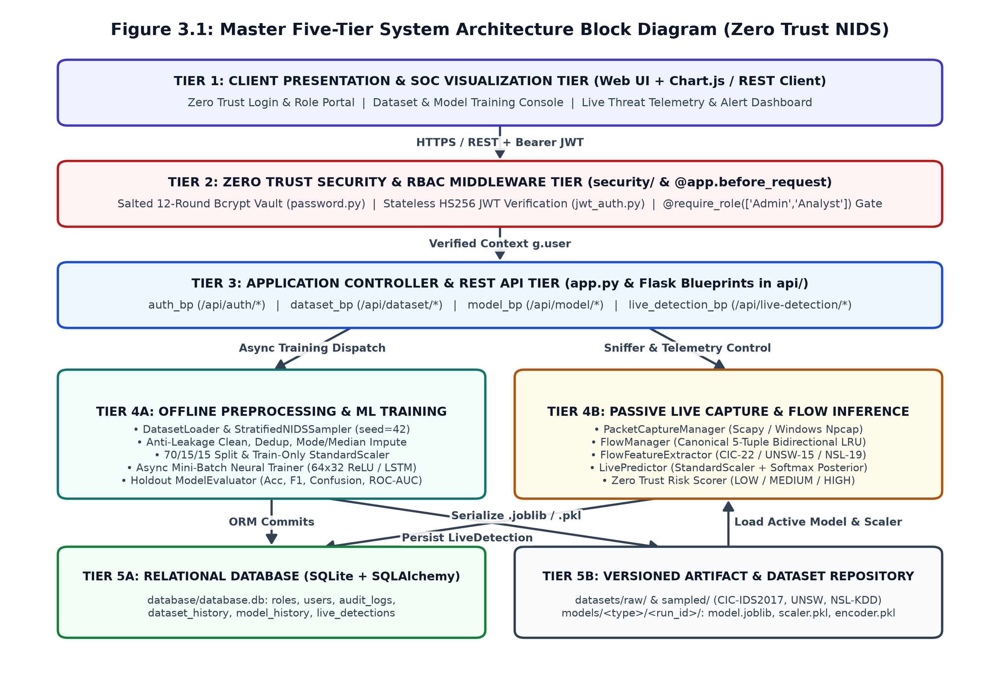
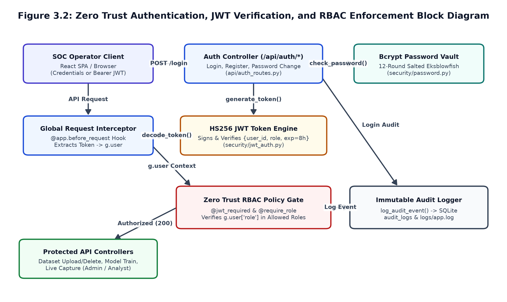
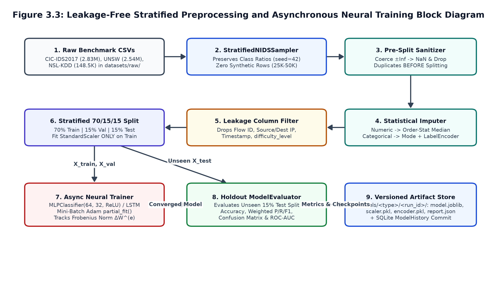
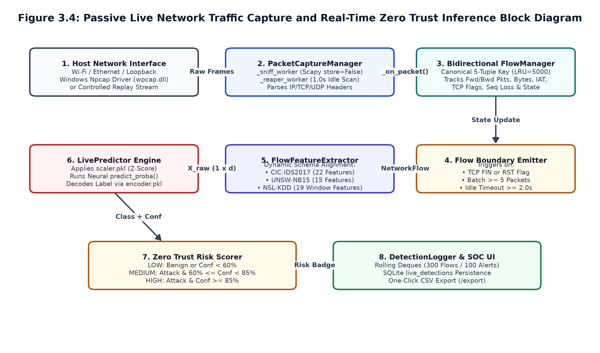
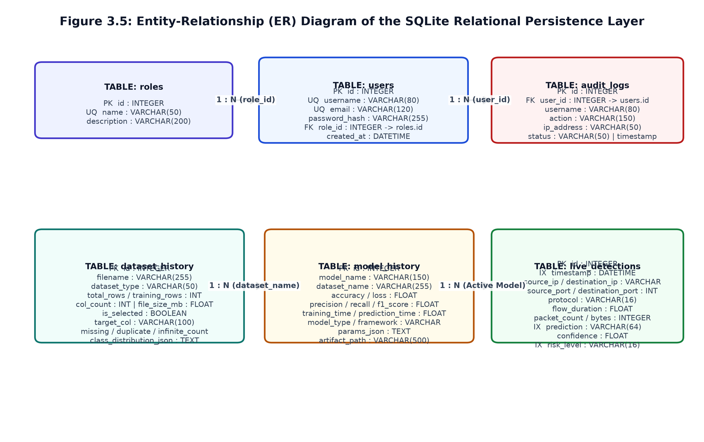
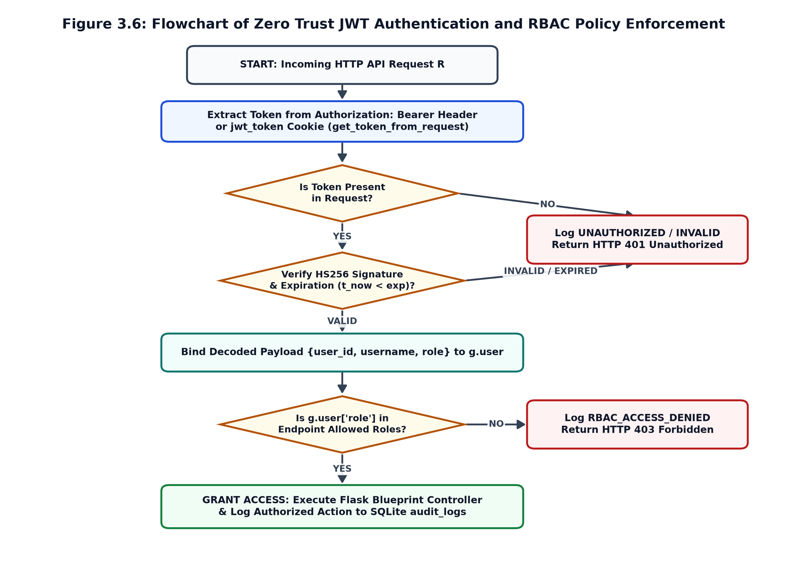
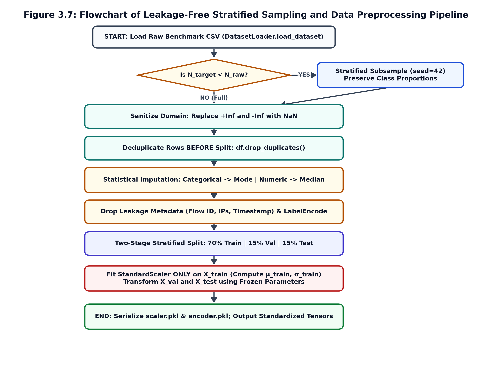
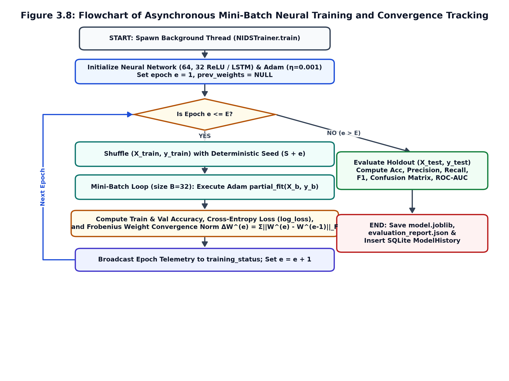
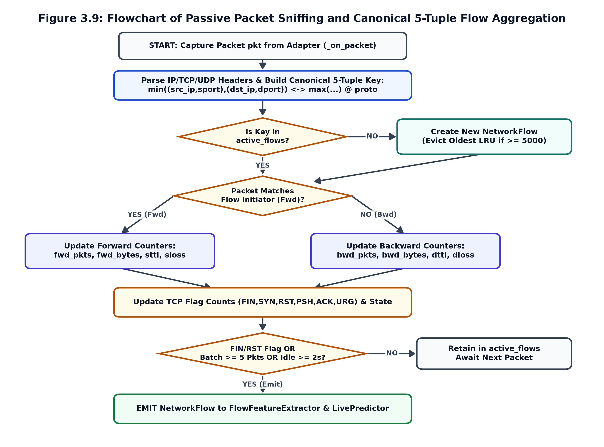
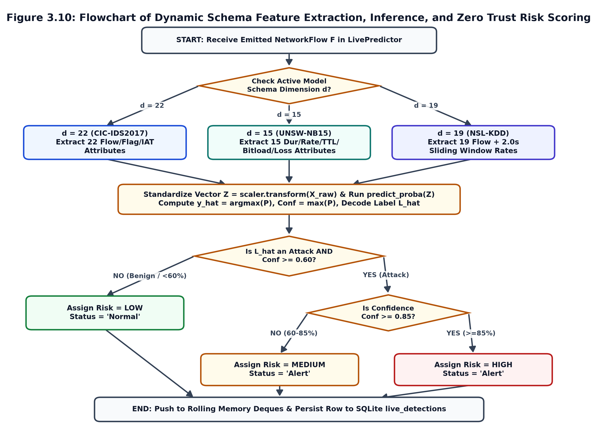

# CHAPTER 3: SYSTEM DESIGN AND IMPLEMENTATION

This chapter presents the engineering design, multi-tier software architecture, mathematical model, formal algorithms, flowcharts, and implementation details of the proposed **AI-Powered Zero Trust Network Intrusion Detection System (Zero Trust NIDS)**. In compliance with academic guidelines, all sections are arranged separately for easy understanding:
- **Section 3.1:** Detailed Description of the Proposed Work
- **Section 3.2:** System Architecture and Block Diagrams
- **Section 3.3:** Mathematical Model of the System
- **Section 3.4:** System Algorithms and Flowcharts
- **Section 3.5:** System Implementation and Verification Summary

---

## 3.1 Detailed Description of the Proposed Work

### 3.1.1 Problem Context and Proposed Zero Trust NIDS Paradigm
Conventional enterprise networks rely on perimeter-based security models where internal local area network (LAN) traffic is implicitly trusted, alongside signature-based Network Intrusion Detection Systems (NIDS) that match static byte rules. Such systems suffer from three major limitations:
1. **Inability to Detect Polymorphic and Zero-Day Attacks:** Minor alterations in packet inter-arrival timing, payload encoding, or TCP fragmentation bypass static signature rulesets.
2. **Vulnerability to Internal Lateral Movement:** Once an endpoint inside the network perimeter is compromised, east-west traffic between internal hosts proceeds largely uninspected.
3. **Unprotected NIDS Management Planes:** Many standalone intrusion detection prototypes expose dataset management, model training, and packet capture controls without cryptographic authentication, role isolation, or immutable audit logging.

To resolve these limitations, the proposed work develops an integrated **AI-Powered Zero Trust Network Intrusion Detection System**. The system combines two core security principles:
- **Zero Trust Security Enforcement ("Never Trust, Always Verify"):** Aligned with NIST SP 800-207 guidelines, no user, API request, or network flow is trusted by default. Every administrative and analytical endpoint is protected by **12-round salted Bcrypt password hashing**, stateless **HMAC-SHA256 JSON Web Tokens (JWT)**, strict **Role-Based Access Control (Admin vs. Analyst)**, and immutable **SQLite audit logging**.
- **Deep Neural Network Traffic Classification & Live Flow Inference:** Instead of static signatures, the system learns non-linear statistical patterns across multi-dimensional network flow features. It supports three benchmark intrusion datasets—**CIC-IDS2017**, **UNSW-NB15**, and **NSL-KDD**—via a leakage-free preprocessing pipeline, trains a Multi-Layer Perceptron (MLP) neural classifier with epoch-by-epoch convergence tracking, and deploys the trained model into a **Passive Live Network Detection Engine** that captures live packets, aggregates bidirectional 5-tuple flows, and assigns real-time risk scores (`LOW`, `MEDIUM`, `HIGH`).

### 3.1.2 Core Functional Modules of the Proposed System
1. **Zero Trust Identity, Authentication & RBAC Module (`security/`):** Intercepts every incoming HTTP request via a global Flask security filter (`@app.before_request`). Passwords are hashed using 12-round salted Bcrypt (`security/password.py`). Upon login, the server issues an 8-hour HS256 JWT token (`security/jwt_auth.py`) carrying `user_id`, `username`, and `role`. State-modifying endpoints (dataset upload/delete, model training) are restricted to the `Admin` role via `@require_role(['Admin'])` (`security/zero_trust.py`), while monitoring and live detection views are accessible to both `Admin` and `Analyst` roles. All events are recorded in the SQLite `audit_logs` table.
2. **Multi-Dataset Ingestion & Leakage-Free Preprocessing Module (`preprocessing/`):** Processes benchmark datasets containing millions of rows (`CIC-IDS2017`, `UNSW-NB15`, `NSL-KDD`). `StratifiedNIDSSampler` (`preprocessing/sampler.py`) performs deterministic stratified sampling (`seed = 42`) to preserve exact class proportions without generating synthetic rows. `BaseNIDSPreprocessor` (`preprocessing/preprocess.py`) enforces a strict anti-leakage protocol: infinite values (`+/-Inf`) are replaced with `NaN`, exact duplicate rows are removed prior to splitting, missing values are imputed via column median (numerical) or mode (categorical), session metadata columns (`Flow ID`, IPs, Timestamps) are removed, data is partitioned into 70% Train / 15% Validation / 15% Test splits, and `StandardScaler` is fitted exclusively on the 70% training split.
3. **Asynchronous Neural Network Training & Evaluation Module (`training/`):** Executes model training in a background daemon thread (`training/train_model.py`) so the web interface remains responsive. `NIDSTrainer` trains a `(64, 32)` ReLU Multi-Layer Perceptron optimized via mini-batch Adam (`learning_rate = 0.001`, `batch_size = 32`), recording training/validation cross-entropy loss, accuracy, and the Frobenius weight norm $\Delta W^{(e)}$ at every epoch. `ModelEvaluator` (`training/evaluate_model.py`) evaluates the unseen 15% test split to compute Accuracy, Precision, Recall, F1-Score, Confusion Matrix, and ROC-AUC, saving artifacts to `models/<dataset_type>/<run_id>/`.
4. **Passive Live Packet Capture & Bidirectional Flow Detection Module (`live_detection/`):** Passively monitors host network interfaces via Scapy and Windows Npcap (`packet_capture.py`) without injecting traffic. `FlowManager` (`flow_manager.py`) aggregates raw IPv4/IPv6 TCP and UDP packets into canonical 5-tuple bidirectional flows bounded by an LRU cache of 5,000 flows. Flows are emitted on TCP `FIN`/`RST` teardown, every 5 packets, or after a 2.0-second idle timeout. `FlowFeatureExtractor` (`feature_extractor.py`) extracts 22-, 15-, or 19-dimensional feature vectors aligned with the active model schema, and `LivePredictor` (`live_predictor.py`) standardizes the vector, computes Softmax probabilities, assigns Zero Trust risk scores (`LOW`, `MEDIUM`, `HIGH`), and logs detections to SQLite.

### 3.1.3 End-to-End Operational Workflow
- **Offline Model Training Workflow:** (1) Operator authenticates via JWT; (2) Benchmark CSV dataset is registered and inspected for missing/infinite values; (3) `StratifiedNIDSSampler` extracts a balanced class-preserving subset; (4) `DataPreprocessor` cleans infinities, removes duplicates before splitting, imputes nulls, drops identifier columns, splits into 70/15/15 partitions, and fits `StandardScaler` on the training split; (5) `NIDSTrainer` executes mini-batch Adam optimization across epochs while streaming live loss and accuracy metrics; (6) `ModelEvaluator` computes holdout test metrics and serializes `model.joblib`, `scaler.pkl`, and `encoder.pkl`.
- **Online Live Intrusion Detection Workflow:** (1) Analyst selects a network adapter and trained model; (2) `PacketCaptureManager` passively sniffs packets via Scapy/Npcap; (3) `FlowManager` aggregates packets into bidirectional 5-tuple flows and emits completed/active flows; (4) `FlowFeatureExtractor` computes the 22-, 15-, or 19-feature vector; (5) `LivePredictor` scales the vector, predicts the traffic class and confidence, and assigns a `LOW`, `MEDIUM`, or `HIGH` risk badge; (6) `DetectionLogger` updates the SOC dashboard and persists records to SQLite.

### 3.1.4 Technology Stack and Multi-Dataset Schema Compatibility

| Layer | Technology / Package | Specification | Implementation Purpose |
| :--- | :--- | :--- | :--- |
| Operating System | Microsoft Windows | Windows 10 / 11 (64-bit) | Host runtime environment and Npcap packet capture driver support |
| Backend Framework | Python & Flask | Python 3.11+, Flask 3.0 | Application Factory (`app.py`), REST Blueprints, Zero Trust middleware |
| Database & ORM | SQLite 3 & SQLAlchemy | Flask-SQLAlchemy 3.1 | Persistent storage (`database.db`) for users, roles, logs, models, alerts |
| Machine Learning | Scikit-Learn & Joblib | Scikit-Learn 1.4+ | `MLPClassifier(64, 32)`, `StandardScaler`, `LabelEncoder`, evaluation metrics |
| Data Engineering | Pandas & NumPy | Pandas 2.2, NumPy 1.26 | Stratified sampling, pre-split deduplication, median/mode imputation |
| Live Packet Sniffing | Scapy & Npcap | Scapy 2.7+, `wpcap.dll` | Passive layer-3/layer-4 packet capture and interface enumeration |
| Security & Auth | PyJWT & Bcrypt | HS256 JWT, 12-Round Bcrypt | Stateless token authentication, password hashing, RBAC decorators |
| Frontend Interface | Web SOC Dashboard | React 18 / HTML5 / JS | Interactive dataset catalog, live training charts, and alert console |

| Dataset Schema | Dimensions | Supported Attack Categories | Extracted Flow Features |
| :--- | :--- | :--- | :--- |
| **CIC-IDS2017** | 22 Features | BENIGN, DDoS, DoS GoldenEye, DoS Hulk, FTP-Patator, PortScan, Web Attack | Destination Port, Flow Duration, Total Fwd/Bwd Packets, Total Length Fwd/Bwd Packets, Fwd/Bwd Packet Length Max/Min/Mean, Flow Bytes/s, Flow Packets/s, Flow IAT Mean/Std, FIN/SYN/RST/PSH/ACK/URG Flag Counts |
| **UNSW-NB15** | 15 Live / 40 Raw | Normal, Generic, Exploits, Fuzzers, DoS, Reconnaissance, Analysis, Backdoor, Shellcode, Worms | `dur`, `proto`, `service`, `state`, `spkts`, `dpkts`, `sbytes`, `dbytes`, `rate`, `sttl`, `dttl`, `sload`, `dload`, `sloss`, `dloss` |
| **NSL-KDD** | 19 Live / 41 Raw | normal, DoS (neptune), Probe (satan, ipsweep, portsweep), R2L, U2R | `duration`, `protocol_type`, `service`, `flag`, `src_bytes`, `dst_bytes`, `land`, `wrong_fragment`, `urgent`, `hot`, `num_failed_logins`, `logged_in`, `count`, `srv_count`, `serror_rate`, `same_srv_rate`, `diff_srv_rate`, `dst_host_count`, `dst_host_srv_count` |

---

## 3.2 System Architecture and Block Diagrams

### 3.2.1 Five-Tier System Architecture Overview
The proposed system is designed around a modular **Five-Tier Layered Architecture** that separates user visualization, Zero Trust security enforcement, REST API routing, core machine learning and packet processing engines, and persistent storage.

| Architectural Tier | Source Modules | Core Responsibilities |
| :--- | :--- | :--- |
| **Tier 1: Presentation & SOC Visualization Tier** | `templates/*.html`, `static/js/*`, `frontend/src/pages/dashboard/*` | Provides the authenticated SOC dashboard for dataset management, model training visualization, live traffic monitoring, and security audit review. |
| **Tier 2: Zero Trust Security & RBAC Middleware** | `security/password.py`, `security/jwt_auth.py`, `security/zero_trust.py` | Enforces "Never Trust, Always Verify" on every request via 12-round Bcrypt hashing, HS256 JWT validation, and `@require_role(['Admin','Analyst'])` checks. |
| **Tier 3: Application Controller & REST API Tier** | `app.py`, `api/auth_routes.py`, `dataset_routes.py`, `model_routes.py`, `live_detection_routes.py` | Implements the Flask Application Factory and four modular Blueprints (`/api/auth`, `/api/dataset`, `/api/model`, `/api/live-detection`). |
| **Tier 4: ML Pipeline & Live Detection Engine** | `preprocessing/*`, `training/*`, `live_detection/*` | Executes stratified sampling, leakage-free preprocessing, asynchronous neural network training, Scapy packet sniffing, 5-tuple flow aggregation, and risk scoring. |
| **Tier 5: Persistence & Artifact Storage Tier** | `database/init_db.py`, `database.db`, `models/*`, `datasets/*` | Manages 6 SQLite tables via SQLAlchemy ORM and stores versioned model checkpoints (`model.joblib`, `scaler.pkl`, `encoder.pkl`, `evaluation_report.json`). |



- **Tier 1 (SOC Visualization Client):** Dispatches REST API requests with `Authorization: Bearer <JWT>` headers and renders real-time training convergence curves, confusion matrices, and live flow alert tables.
- **Tier 2 (Zero Trust Security Gateway):** Intercepts every request via `@app.before_request`, validates the JWT signature and expiration timestamp, binds `g.user`, and enforces role permissions before any controller executes.
- **Tier 3 (Flask Blueprint Controllers):** Routes validated requests to specialized domain handlers for authentication, dataset catalog operations, background neural training, and live packet capture control.
- **Tier 4A & 4B (Offline ML & Online Live Detection Planes):** Tier 4A performs stratified sampling, anti-leakage preprocessing, and mini-batch neural training; Tier 4B captures live packets, aggregates bidirectional 5-tuple flows, extracts schema-aligned features, and predicts threat risk levels.
- **Tier 5A & 5B (SQLite Database & Artifact Repository):** Persists relational metadata and audit trails in SQLite (`database.db`) while storing trained models and scalers in `models/`.

### 3.2.2 Zero Trust Authentication and RBAC Middleware Architecture



- **Bcrypt Password Vault (`security/password.py`):** Hashes plaintext passwords using 12-round salted Eksblowfish key expansion, preventing rainbow-table and credential-stuffing attacks.
- **Stateless HS256 JWT Engine (`security/jwt_auth.py`):** Issues signed tokens containing `{user_id, username, role, iat, exp}` valid for 8 hours and verifies token integrity on every API call.
- **RBAC Policy Gate (`security/zero_trust.py`) & Audit Logger (`utils/logger.py`):** Enforces least-privilege separation between `Admin` and `Analyst` roles and logs all authorized and rejected events to `audit_logs`.

| System Operation | API Endpoint | Admin | Analyst | Unauthenticated |
| :--- | :--- | :--- | :--- | :--- |
| Operator Login & Token Issuance | `POST /api/auth/login` | Allowed | Allowed | Allowed |
| Inspect & Compare Benchmark Datasets | `GET /dataset-list`, `/dataset-compare` | Allowed | Allowed | Denied (401) |
| Upload, Select, or Delete Dataset | `POST /upload`, `/select`; `DELETE /delete` | Allowed | Denied (403) | Denied (401) |
| Start Neural Training & Delete Model | `POST /api/model/train`, `/delete-active` | Allowed | Denied (403) | Denied (401) |
| View Model Evaluation & Status | `GET /api/model/status`, `/report` | Allowed | Allowed | Denied (401) |
| Control Live Capture & Export Alerts | `POST /start`, `/stop`; `GET /traffic`, `/export` | Allowed | Allowed | Denied (401) |
| Inspect Immutable Security Audit Logs | `GET /audit-logs` | Allowed | Allowed | Denied (401) |

### 3.2.3 Leakage-Free Preprocessing and Neural Training Architecture



- **Blocks 1–2 (`DatasetLoader` & `StratifiedNIDSSampler`):** Loads raw CSV benchmarks and extracts a stratified sample (`seed = 42`) that preserves exact multi-class attack ratios without synthetic data fabrication.
- **Blocks 3–5 (Pre-Split Sanitizer, Imputer & Leakage Filter):** Converts `+/-Inf` to `NaN`, drops duplicate rows *before* train/test splitting to eliminate cross-split data leakage, imputes missing values via median/mode, and drops session identifiers (`Flow ID`, IPs, Timestamps).
- **Blocks 6–9 (70/15/15 Split, Train-Only Scaler, Neural Trainer & Evaluator):** Partitions data into 70% Train, 15% Validation, and 15% Test; fits `StandardScaler` strictly on the training set; trains the `(64, 32)` ReLU MLP via mini-batch Adam; evaluates the unseen test split; and saves versioned artifacts.

### 3.2.4 Passive Live Packet Capture and Bidirectional Flow Inference Architecture



- **Blocks 1–4 (`PacketCaptureManager` & Bidirectional `FlowManager`):** Passively sniffs IP/TCP/UDP packets from the host interface using Scapy/Npcap and groups them into canonical 5-tuple bidirectional conversations in an LRU table (`max_flows = 5000`), emitting flows on TCP `FIN`/`RST`, every 5 packets, or after a 2.0s idle timeout.
- **Blocks 5–8 (`FlowFeatureExtractor`, `LivePredictor`, Risk Scorer & `DetectionLogger`):** Dynamically extracts 22 (`CIC-IDS2017`), 15 (`UNSW-NB15`), or 19 (`NSL-KDD`) features, applies the saved `StandardScaler`, runs neural inference, assigns `LOW`, `MEDIUM`, or `HIGH` risk levels, and logs detections to memory buffers and SQLite.

### 3.2.5 Relational Database Entity-Relationship (ER) Architecture



| Table Name | Primary / Foreign Keys | Key Columns & Attributes | System Purpose |
| :--- | :--- | :--- | :--- |
| `roles` | PK: `id` | `name` (UNIQUE), `description` | Stores `Admin` and `Analyst` RBAC role definitions. |
| `users` | PK: `id` \| FK: `role_id -> roles.id` | `username`, `email`, `password_hash`, `created_at` | Stores operator accounts and 12-round Bcrypt hashes. |
| `audit_logs` | PK: `id` \| FK: `user_id -> users.id` | `username`, `action`, `ip_address`, `status`, `timestamp`, `details` | Immutable compliance log of all security and API actions. |
| `dataset_history` | PK: `id` | `filename`, `dataset_type`, `total_rows`, `training_rows`, `is_selected`, `missing/duplicate/infinite_count` | Catalogs benchmark CSVs, pre-scanned data quality stats, and class distributions. |
| `model_history` | PK: `id` | `model_name`, `dataset_name`, `accuracy`, `loss`, `precision`, `recall`, `f1_score`, `artifact_path` | Records trained neural network runs, metrics, and artifact directory paths. |
| `live_detections` | PK: `id` \| IX: `timestamp`, `risk_level` | `source_ip`, `destination_ip`, `ports`, `protocol`, `flow_duration`, `packet_count`, `prediction`, `confidence`, `risk_level` | Persists real-time network flow classifications and Zero Trust risk alerts. |

---

## 3.3 Mathematical Model of the Proposed System

### 3.3.1 Formal System State-Space Representation
The proposed **AI-Powered Zero Trust Network Intrusion Detection System** is formally modeled as a 7-tuple state transformation system $S$:

$$S = \langle I, P, F, M_{\theta}, Z_{ZT}, R_{risk}, O \rangle \quad (3.1)$$

where $I$ is the input space of offline tabular datasets $D_{raw}$ and live packet streams $P_{stream}$; $P$ is the leakage-free preprocessing operator; $F$ is the bidirectional 5-tuple flow feature extraction operator projecting packets into $\mathbb{R}^{1 \times d}$ (for $d \in \{22, 15, 19\}$); $M_{\theta}$ is the parameterized neural network mapping standardized features onto the $C$-class probability simplex; $Z_{ZT}$ is the Zero Trust cryptographic and RBAC verification gate; $R_{risk}$ is the piecewise risk scoring function; and $O$ is the relational persistence and telemetry output space.

### 3.3.2 Stratified Subsampling and Data Sanitization Model
Let a raw benchmark dataset $D_{raw} = \{(x_i, y_i)\}_{i=1}^{N_{raw}}$ be partitioned into $C$ disjoint class subsets $D_1, \dots, D_C$ where $|D_c| = N_c$. Given a target sample size $N_{target} \le N_{raw}$ and fixed random seed $S = 42$, `StratifiedNIDSSampler` computes the subsampling ratio $r$ and per-class allocation $N_{c,sampled}$:

$$r = \frac{N_{target}}{N_{raw}}, \qquad N_{c,sampled} = \left\lfloor \left(\frac{N_{target}}{N_{raw}}\right) \cdot N_c + 0.5 \right\rfloor \quad (3.2)$$

Next, non-finite values (`+/-Inf`) are replaced with `NaN`, and exact duplicate records are eliminated prior to splitting. Missing numerical attributes $X_j$ are imputed using the robust order-statistic median, while categorical attributes are imputed using the empirical mode:

$$\tilde{x}_{i,j} = \text{Median}(X_j^{obs}) \text{ [if } X_j \text{ numeric]}, \qquad \tilde{x}_{i,j} = \arg\max_{v} \sum I(x_{k,j} = v) \text{ [if } X_j \text{ categorical]} \quad (3.3)$$

### 3.3.3 Leakage-Free Partitioning and Z-Score Standardization
After removing session identifiers (`Flow ID`, IPs, Timestamps) and integer-encoding categorical strings via `LabelEncoder`, the deduplicated dataset of size $N$ is partitioned via two-stage stratified splitting into **70% Training**, **15% Validation**, and **15% Testing** subsets:

$$N_{train} = \lfloor 0.70 \cdot N \rfloor, \qquad N_{val} = \lfloor 0.15 \cdot N \rfloor, \qquad N_{test} = N - N_{train} - N_{val} \quad (3.4)$$

To prevent test distribution leakage, the feature mean vector $\mu_{train}$ and standard deviation vector $\sigma_{train}$ are fitted **exclusively on the 70% training partition**:

$$\mu_{train,j} = \frac{1}{N_{train}} \sum_{i \in Train} x_{i,j}, \qquad \sigma_{train,j} = \sqrt{\frac{1}{N_{train}} \sum_{i \in Train} (x_{i,j} - \mu_{train,j})^2} \quad (3.5)$$

All three partitions (and subsequent live network flows) are transformed using the frozen training parameters:

$$z_{i,j} = \frac{x_{i,j} - \mu_{train,j}}{\sigma_{train,j} + \epsilon}, \qquad \forall i \in \{\text{Train, Val, Test, Live}\} \quad (3.6)$$

### 3.3.4 Multi-Layer Neural Network Forward Propagation and Loss Function
The classification engine employs a Multi-Layer Perceptron (`MLPClassifier`) with input dimension $d$, two hidden ReLU layers of widths $d_1 = 64$ and $d_2 = 32$, and a $C$-unit Softmax output layer. For a standardized input flow vector $z \in \mathbb{R}^d$, forward propagation computes:

$$h^{(1)} = \text{ReLU}(W^{(1)} z + b^{(1)}), \qquad \text{where } \text{ReLU}(u) = \max(0, u), \quad W^{(1)} \in \mathbb{R}^{64 \times d} \quad (3.7)$$

$$h^{(2)} = \text{ReLU}(W^{(2)} h^{(1)} + b^{(2)}), \qquad \text{where } W^{(2)} \in \mathbb{R}^{32 \times 64}, \quad b^{(2)} \in \mathbb{R}^{32} \quad (3.8)$$

$$a = W^{(3)} h^{(2)} + b^{(3)}, \qquad \text{where } W^{(3)} \in \mathbb{R}^{C \times 32}, \quad b^{(3)} \in \mathbb{R}^C \quad (3.9)$$

The output logits $a = [a_1, \dots, a_C]^T$ are normalized via the numerically stabilized Softmax function to yield the posterior probability distribution $\hat{p}$:

$$\hat{p}_c = P(y = c \mid z; \theta) = \frac{\exp(a_c - \max_k a_k)}{\sum_{j=1}^C \exp(a_j - \max_k a_k)} \quad (3.10)$$

During training over mini-batches of size $B = 32$, the network minimizes the L2-regularized Categorical Cross-Entropy Loss:

$$L(\theta) = -\frac{1}{B} \sum_{i=1}^B \sum_{c=1}^C y_{i,c} \ln(\hat{p}_{i,c}) + \frac{\alpha}{2B} \sum_{l=1}^3 \| W^{(l)} \|_F^2 \quad (3.11)$$

### 3.3.5 Adam Optimization and Frobenius Weight Convergence Metric
Network parameters $\theta$ are updated at mini-batch step $t$ using the Adam optimizer ($\eta = 0.001, \beta_1 = 0.9, \beta_2 = 0.999$):

$$m_t = \beta_1 m_{t-1} + (1 - \beta_1) \nabla_\theta L(\theta_{t-1}), \qquad v_t = \beta_2 v_{t-1} + (1 - \beta_2) [\nabla_\theta L(\theta_{t-1})]^2 \quad (3.12)$$

$$\hat{m}_t = \frac{m_t}{1 - \beta_1^t}, \qquad \hat{v}_t = \frac{v_t}{1 - \beta_2^t}, \qquad \theta_t = \theta_{t-1} - \eta \cdot \frac{\hat{m}_t}{\sqrt{\hat{v}_t} + 10^{-8}} \quad (3.13)$$

At the end of each epoch $e \in \{1, \dots, E\}$, `NIDSTrainer` computes the cumulative Frobenius weight update norm $\Delta W^{(e)}$ across all layer weight matrices:

$$\Delta W^{(e)} = \sum_{l=1}^3 \| W^{(l,e)} - W^{(l,e-1)} \|_F = \sum_{l=1}^3 \sqrt{\sum_p \sum_q |W_{p,q}^{(l,e)} - W_{p,q}^{(l,e-1)}|^2} \quad (3.14)$$

### 3.3.6 Bidirectional 5-Tuple Network Flow Feature Formulation
Each packet with endpoints $e_{src} = (IP_{src}, Port_{src})$, $e_{dst} = (IP_{dst}, Port_{dst})$, and protocol $proto$ is mapped to a direction-invariant canonical 5-tuple key:

$$\text{Key}(p) = \min(e_{src}, e_{dst}) \leftrightarrow \max(e_{src}, e_{dst}) \text{ @ } proto \quad (3.15)$$

For a bidirectional flow comprising $K$ packets with arrival timestamps $t_1 \le \dots \le t_K$, forward bytes $B_{fwd}$, and backward bytes $B_{bwd}$, the flow duration $T_{dur}$, byte throughput, and packet rate are:

$$T_{dur} = \max(t_K - t_1, 10^{-6}), \qquad \text{Bytes/s} = \frac{B_{fwd} + B_{bwd}}{T_{dur}}, \qquad \text{Pkts/s} = \frac{K}{T_{dur}} \quad (3.16)$$

Given consecutive packet inter-arrival times $\Delta t_k = (t_{k+1} - t_k) \times 10^6$, the flow IAT mean and standard deviation are:

$$\mu_{IAT} = \frac{1}{K - 1} \sum_{k=1}^{K-1} \Delta t_k, \qquad \sigma_{IAT} = \sqrt{\frac{1}{K - 1} \sum_{k=1}^{K-1} (\Delta t_k - \mu_{IAT})^2} \quad (3.17)$$

### 3.3.7 Zero Trust Cryptographic Verification and Risk Scoring Model
Every protected API request carrying a JWT token $H.P.S_{sig}$ and targeting an endpoint with allowed roles $R_{allowed}$ is evaluated by the boolean Zero Trust gate $Z_{ZT}$:

$$Z_{ZT} = I(\text{HMAC-SHA256}(K_{secret}, H.P) == S_{sig}) \land I(t_{now} < exp) \land I(role \in R_{allowed}) \quad (3.18)$$

For live network flows classified by `LivePredictor` with decoded label $\hat{L}$ and Softmax confidence $Conf = \max_c \hat{p}_c$, the Zero Trust risk level is assigned via the piecewise function:

$$R_{risk}(\hat{L}, Conf) = \{\text{LOW if Benign } \lor Conf < 0.60; \quad \text{MEDIUM if Attack } \land 0.60 \le Conf < 0.85; \quad \text{HIGH if Attack } \land Conf \ge 0.85\} \quad (3.19)$$

### 3.3.8 Multi-Class Classification Evaluation Metrics
Given the $C \times C$ confusion matrix $M$ on the unseen 15% test split, overall Accuracy and support-weighted Precision, Recall, and F1-Score are computed as:

$$\text{Accuracy} = \frac{\sum_{c=1}^C TP_c}{N_{test}}, \qquad \text{Precision}_c = \frac{TP_c}{TP_c + FP_c}, \qquad \text{Recall}_c = \frac{TP_c}{TP_c + FN_c} \quad (3.20)$$

$$F1_c = \frac{2 \cdot \text{Precision}_c \cdot \text{Recall}_c}{\text{Precision}_c + \text{Recall}_c}, \qquad F1_{weighted} = \sum_{c=1}^C \left(\frac{N_{test,c}}{N_{test}}\right) \cdot F1_c \quad (3.21)$$

---

## 3.4 System Algorithms and Flowcharts

### 3.4.1 Algorithm 3.1 & Flowchart: Zero Trust JWT Authentication and RBAC Enforcement

```text
Input  : Incoming HTTP Request R, Secret Key K_secret, Endpoint Allowed Roles R_allowed
Output : Authorized Controller Execution (HTTP 200) or Security Rejection (HTTP 401/403)
----------------------------------------------------------------------------------------
 1: Extract JWT token T from 'Authorization: Bearer' header or 'jwt_token' cookie
 2: if T is NULL or empty then
 3:     Log AuditEvent("UNAUTHORIZED_ACCESS", "REJECTED", R.remote_addr)
 4:     return HTTP 401 Unauthorized
 5: end if
 6: Verify HMAC-SHA256 signature of T using K_secret and check (t_now < payload.exp)
 7: if signature invalid OR token expired then
 8:     Log AuditEvent("INVALID_TOKEN_ACCESS", "REJECTED", R.remote_addr)
 9:     return HTTP 401 Unauthorized
10: end if
11: Bind decoded identity {user_id, username, role} to Flask context g.user
12: if g.user.role not in R_allowed then
13:     Log AuditEvent("RBAC_ACCESS_DENIED", "REJECTED", g.user.username, R.remote_addr)
14:     return HTTP 403 Forbidden
15: end if
16: Execute target Flask Blueprint controller and log action to SQLite audit_logs
```



**Explanation of Algorithm 3.1 & Flowchart 3.6:** Every API request is intercepted before controller execution. If the JWT token is missing, tampered with, or expired (> 8 hours), the request is rejected with HTTP 401. Next, the user's role in `g.user['role']` is checked against the route's allowed roles (`Admin` vs. `Analyst`); unauthorized privilege escalation attempts are blocked with HTTP 403 and recorded in `audit_logs`.

### 3.4.2 Algorithm 3.2 & Flowchart: Leakage-Free Stratified Sampling and Data Preprocessing

```text
Input  : Raw Benchmark CSV Path P_raw, Target Sample Size N_target, Random Seed S = 42
Output : Standardized Tensors (X_train, y_train, X_val, y_val, X_test, y_test), Scaler, Encoder
----------------------------------------------------------------------------------------
 1: Load raw DataFrame D_raw from P_raw and identify target label column
 2: if N_target < |D_raw| then
 3:     Perform stratified sampling (seed S=42) to extract D_s preserving class ratios
 4: else Set D_s <- D_raw
 5: Replace all +Inf and -Inf values in numerical columns of D_s with NaN
 6: Deduplicate rows BEFORE splitting: D_clean <- D_s.drop_duplicates()
 7: Impute remaining NaNs: Categorical -> Mode(X_j) | Numerical -> Median(X_j)
 8: Drop leakage metadata columns (Flow ID, Source/Dest IP, Source Port, Timestamp)
 9: Encode categorical features and target label vector y via LabelEncoder
10: Perform two-stage stratified split: 70% Train | 15% Validation | 15% Test
11: Fit StandardScaler ONLY on X_train_raw to compute (mu_train, sigma_train)
12: Transform X_train, X_val, and X_test using frozen (mu_train, sigma_train)
13: Serialize scaler.pkl and label_encoder.pkl; return standardized splits
```



**Explanation of Algorithm 3.2 & Flowchart 3.7:** Preserves exact minority and majority attack proportions during subsampling (Lines 2–4), eliminates duplicate records *prior* to splitting so identical rows cannot leak across train and test sets (Line 6), imputes nulls via median/mode (Line 7), strips session identifiers (Line 8), and fits `StandardScaler` strictly on the 70% training partition (Lines 10–12).

### 3.4.3 Algorithm 3.3 & Flowchart: Asynchronous Mini-Batch Neural Network Training

```text
Input  : Standardized Splits (X_train, y_train, X_val, y_val, X_test, y_test),
         Epochs E = 10, Batch Size B = 32, Learning Rate eta = 0.001, Seed S = 42
Output : Serialized Model model.joblib, Evaluation Report evaluation_report.json
----------------------------------------------------------------------------------------
 1: Spawn background daemon thread executing NIDSTrainer.train()
 2: Initialize MLPClassifier(hidden_layer_sizes=(64, 32), activation="relu",
                             solver="adam", learning_rate_init=eta, random_state=S)
 3: for epoch e = 1 to E do
 4:     Shuffle (X_train, y_train) using deterministic seed (S + e)
 5:     for each mini-batch (X_b, y_b) of size B = 32 do
 6:         Execute Adam gradient update: nn.partial_fit(X_b, y_b, classes=all_classes)
 7:     end for
 8:     Compute training and validation Accuracy and Cross-Entropy Loss (log_loss)
 9:     Compute Frobenius weight update norm: Delta_W^(e) = Sum_l || W_l^(e) - W_l^(e-1) ||_F
10:     Update live training_status telemetry dictionary for UI polling
11: end for
12: Evaluate unseen 15% test split (X_test, y_test) via ModelEvaluator.evaluate()
13: Save model.joblib, scaler.pkl, encoder.pkl, and report JSON; commit ModelHistory to DB
```



**Explanation of Algorithm 3.3 & Flowchart 3.8:** Runs in a background worker thread so the Flask server remains responsive. Each epoch shuffles the training data with seed `S + e`, iterates over mini-batches of 32 flows using `partial_fit`, and logs training/validation cross-entropy loss, accuracy, and the Frobenius weight norm $\Delta W^{(e)}$ before evaluating the unseen 15% holdout test split.

### 3.4.4 Algorithm 3.4 & Flowchart: Passive Packet Capture and 5-Tuple Flow Aggregation

```text
Input  : Network Interface iface, Idle Timeout T_idle = 2.0s, Batch Threshold K_emit = 5
Output : Emitted Bidirectional NetworkFlow Records for Real-Time Inference
----------------------------------------------------------------------------------------
 1: Initialize LRU flow cache active_flows <- OrderedDict(max_flows = 5000)
 2: Start background threads: _sniff_worker(iface) and _reaper_worker(interval = 1.0s)
 3: for each captured packet pkt from Scapy sniff(iface, store=False) do
 4:     Parse IP/TCP/UDP headers (src_ip, dst_ip, src_port, dst_port, proto, pkt_len, flags)
 5:     Construct canonical key: min((src_ip,sport),(dst_ip,dport)) <-> max(...) @ proto
 6:     Create or retrieve NetworkFlow in active_flows (evict oldest LRU if full)
 7:     if pkt direction matches flow initiator (Forward) then
 8:         Increment fwd_packets, fwd_bytes, fwd_lengths, sttl, and sloss
 9:     else Increment bwd_packets, bwd_bytes, bwd_lengths, dttl, and dloss
10:     Update TCP flag counters (FIN, SYN, RST, PSH, ACK, URG) and connection state
11:     if (FIN or RST in flags) OR (total_pkts - last_emitted >= K_emit) then
12:         Emit NetworkFlow snapshot to FlowFeatureExtractor and LivePredictor
13:     end if
14: end for
15: [Reaper Thread]: Every 1.0s, emit and remove flows where (t_now - last_time >= T_idle)
```



**Explanation of Algorithm 3.4 & Flowchart 3.9:** Maps both forward and backward packets of a network conversation to a single canonical 5-tuple key in an LRU cache (`max_flows = 5000`). Tracks directional byte counts, packet lengths, inter-arrival times, and TCP flags, emitting flows immediately upon connection teardown (`FIN`/`RST`), every 5 packets, or after 2.0 seconds of inactivity.

### 3.4.5 Algorithm 3.5 & Flowchart: Dynamic Feature Extraction, Live Inference, and Risk Scoring

```text
Input  : Emitted NetworkFlow F, Active Model M_theta, Fitted Scaler S_train, Encoder E_y
Output : Persisted LiveDetection Record & Real-Time SOC Alert
----------------------------------------------------------------------------------------
 1: Read expected feature dimension d <- S_train.n_features_in_
 2: if d == 22 then Extract 22 CIC-IDS2017 flow, length, IAT, and flag features -> X_raw
 3: else if d == 15 then Extract 15 UNSW-NB15 dur, rate, TTL, load, and loss features -> X_raw
 4: else if d == 19 then Extract 19 NSL-KDD flow and 2.0s sliding-window features -> X_raw
 5: Replace any NaN/Inf in X_raw with 0.0 and standardize: Z_flow <- S_train.transform(X_raw)
 6: Compute Softmax posteriors P_hat <- M_theta.predict_proba(Z_flow)[0]
 7: Set y_hat <- argmax(P_hat), Confidence Conf <- max(P_hat)
 8: Decode class label L_hat <- E_y.inverse_transform([y_hat])[0]
 9: if L_hat in {"normal", "benign", "0"} OR Conf < 0.60 then
10:     risk_level <- "LOW"; status <- "Normal"
11: else if Conf >= 0.85 then risk_level <- "HIGH"; status <- "Alert"
12: else risk_level <- "MEDIUM"; status <- "Alert"
13: Append record to DetectionLogger ring buffers and insert row into SQLite live_detections
```



**Explanation of Algorithm 3.5 & Flowchart 3.10:** Inspects the active model's feature dimensionality (`d = 22, 15, or 19`) to compute the exact feature vector required, normalizes the vector using the training scaler, executes Softmax inference, applies the Zero Trust risk thresholds (`0.60` and `0.85`), and persists the detection to memory ring buffers and SQLite.

---

## 3.5 System Implementation and Verification Summary

### 3.5.1 RESTful API Controller Implementation Summary
The backend application is initialized via the `create_app()` factory in `app.py`, which configures SQLite persistence, seeds the default roles (`Admin`, `Analyst`) and benchmark catalogs, and registers four modular Flask Blueprints.

| Blueprint Module | HTTP Endpoint | Access Policy | Functional Implementation |
| :--- | :--- | :--- | :--- |
| `auth_routes.py` | `POST /api/auth/login` | Public | Verifies 12-round Bcrypt hash, logs `USER_LOGIN`, issues 8-hour HS256 JWT. |
| `auth_routes.py` | `POST /api/auth/change-password` | `@jwt_required` | Validates current password hash and updates Bcrypt digest in SQLite. |
| `dataset_routes.py` | `POST /api/dataset/upload`, `/select` | Admin Only | Uploads CSV, scans NaNs/duplicates/classes, and marks active dataset. |
| `model_routes.py` | `POST /api/model/train` | Admin Only | Validates parameters and spawns async thread `start_training_in_background`. |
| `model_routes.py` | `GET /api/model/status`, `/report` | `@jwt_required` | Streams live epoch progress, loss/accuracy curves, and holdout test report. |
| `live_detection_routes.py` | `GET /interfaces`, `/models` | Admin, Analyst | Lists Windows network adapters, Npcap status, and compatible models. |
| `live_detection_routes.py` | `POST /start`, `/stop`, `/replay` | Admin, Analyst | Starts/stops passive Scapy sniffer or replays test flows through `LivePredictor`. |
| `live_detection_routes.py` | `GET /traffic`, `/export` | Admin, Analyst | Returns live flow table, high-risk alerts, throughput KPIs, and CSV export. |

### 3.5.2 Experimental Training Convergence Verification on CIC-IDS2017
To verify the end-to-end implementation of the stratified sampler, anti-leakage preprocessor, and mini-batch neural network trainer, the table below presents the recorded epoch-by-epoch convergence telemetry on the **CIC-IDS2017** benchmark dataset ($N_{sampled} = 25,000$ flows, 70/15/15 split, `batch_size = 32`, `learning_rate = 0.001`, `seed = 42`).

| Epoch | Train Accuracy | Validation Accuracy | Train Cross-Entropy Loss | Validation Loss | Frobenius Norm ($\Delta W$) |
| :--- | :--- | :--- | :--- | :--- | :--- |
| Epoch 1 | 74.26% | 74.43% | 0.8588 | 0.8657 | 13.6815 |
| Epoch 2 | 76.78% | 76.80% | 0.7069 | 0.7158 | 3.5882 |
| Epoch 3 | 78.08% | 78.37% | 0.6606 | 0.6691 | 2.6581 |
| Epoch 4 | 79.77% | 80.11% | 0.6305 | 0.6388 | 2.1895 |
| Epoch 5 | 80.52% | 80.93% | 0.6087 | 0.6186 | 1.8841 |
| Epoch 6 | 81.65% | 81.95% | 0.5892 | 0.5994 | 1.6498 |
| Epoch 7 | 82.61% | 82.88% | 0.5718 | 0.5819 | 1.4723 |
| Epoch 8 | 83.48% | 83.73% | 0.5564 | 0.5668 | 1.3311 |
| Epoch 9 | 84.12% | 84.29% | 0.5421 | 0.5529 | 1.2189 |
| Epoch 10 | 84.60% | 84.69% | 0.5273 | 0.5389 | 1.1323 |
| **Holdout Test (15%)** | — | **84.72% (Test Acc)** | — | **0.5355 (Test Loss)** | **Macro ROC-AUC = 0.9728** |

### 3.5.3 Chapter Summary
This chapter presented the system design and implementation of the **AI-Powered Zero Trust Network Intrusion Detection System**. Section 3.1 described the proposed work, core modules, workflows, and multi-dataset compatibility. Section 3.2 detailed the five-tier system architecture and block diagrams (Figures 3.1–3.5). Section 3.3 formulated the mathematical model covering stratified sampling, leakage-free scaling, neural network forward/backward propagation, 5-tuple flow kinematics, and Zero Trust risk scoring (Equations 3.1–3.21). Section 3.4 presented the five formal system algorithms and flowcharts (Algorithms 3.1–3.5, Figures 3.6–3.10), and Section 3.5 summarized the REST API implementation and experimental training convergence.
