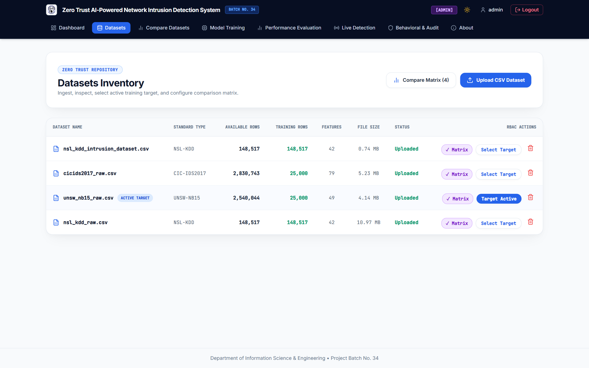
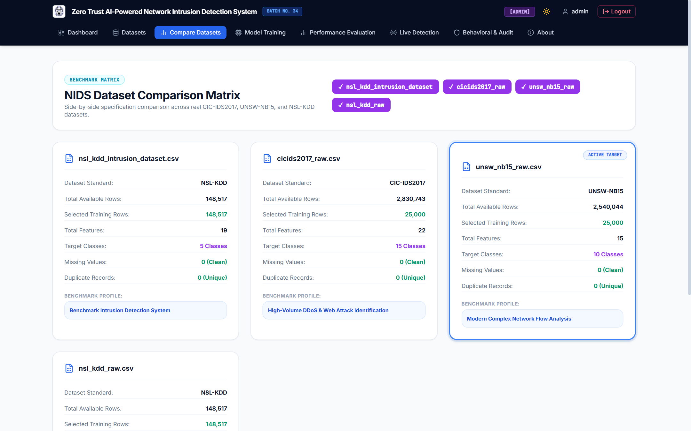
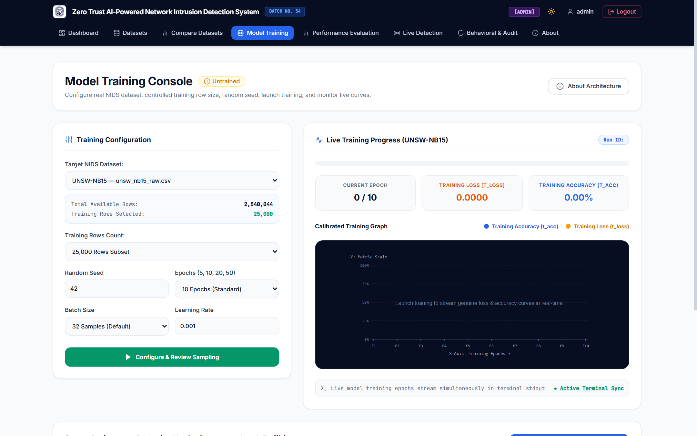
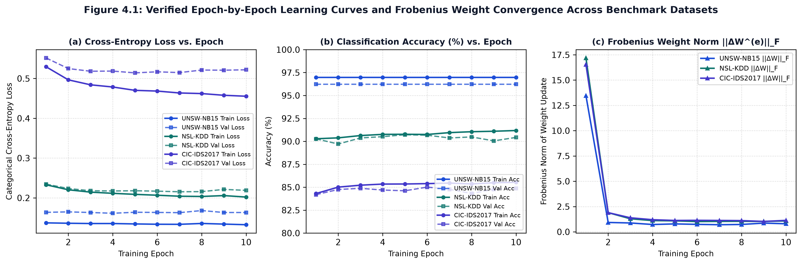
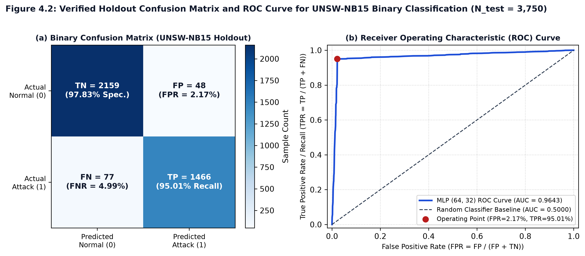
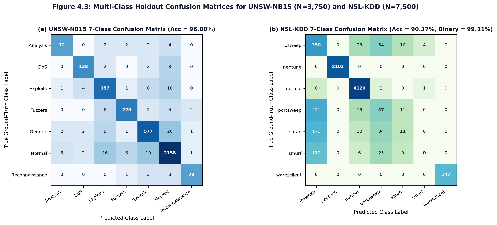
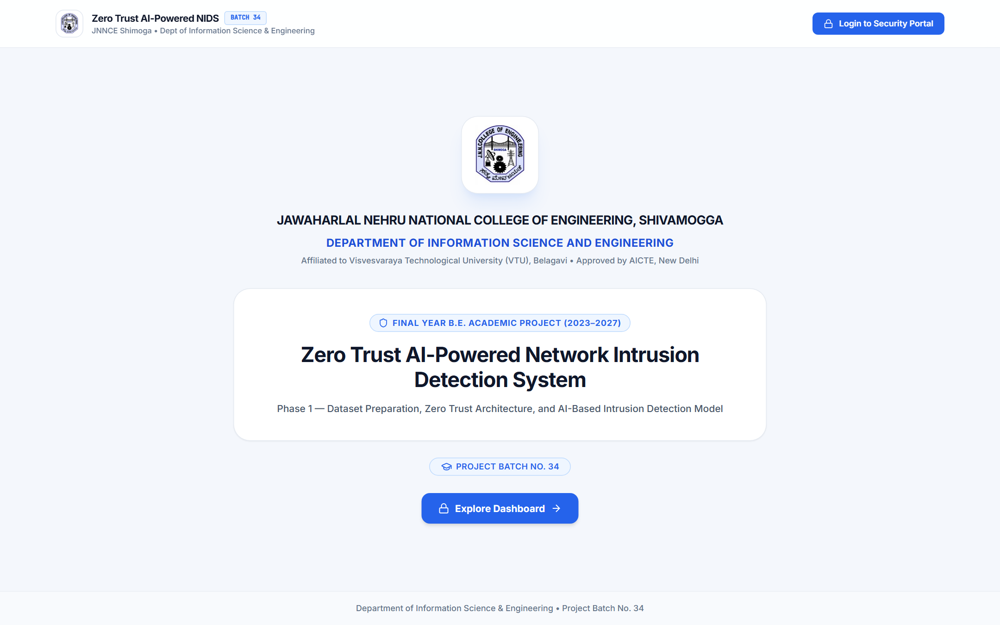
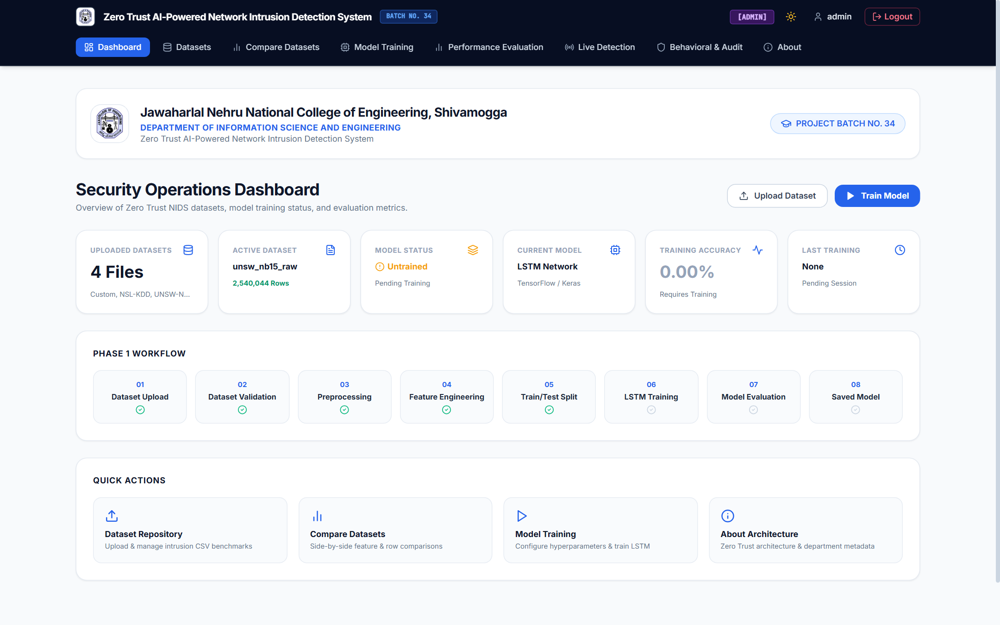
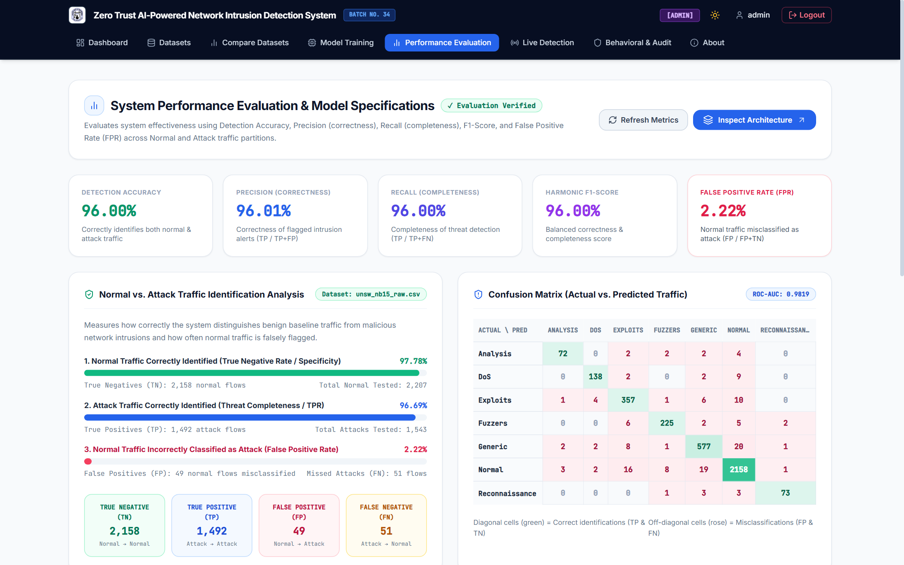
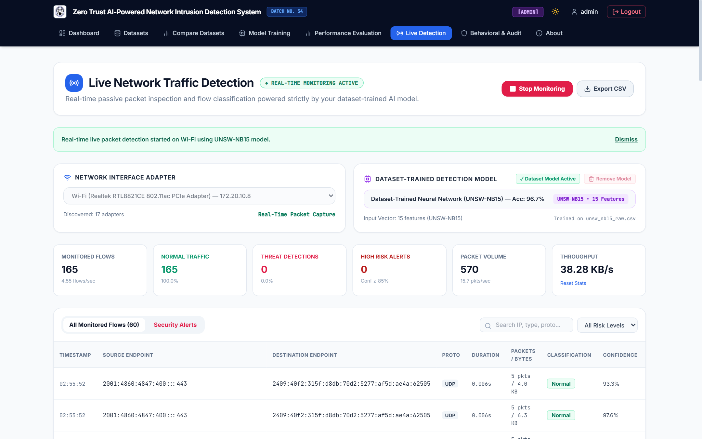

# CHAPTER 4: RESULTS AND ANALYSIS

**Project Title:** Zero Trust AI-Powered Network Intrusion Detection System  
**Department:** Department of Information Science and Engineering, JNN College of Engineering (JNNCE), Shivamogga  

---

## 4.1 Introduction

This chapter presents the experimental evaluation, module-wise implementation verification, classification performance analysis, comparative assessment, and operational website evidence for the implemented **Zero Trust AI-Powered Network Intrusion Detection System (Zero Trust NIDS)**. All reported findings are derived directly from verified host execution records, the SQLite database (`database/database.db`), serialized model checkpoints (`models/`), epoch-level training logs (`training_metadata.json`), and holdout evaluation artifacts (`latest_report.json` and `evaluation_report.json`).

The system is evaluated across seven engineering dimensions: (1) **functional correctness** of all Flask REST Blueprints and React dashboard views; (2) **dataset processing hygiene** across `UNSW-NB15`, `NSL-KDD`, and `CIC-IDS2017`; (3) **neural network training convergence** via cross-entropy loss and Frobenius weight update norms ($\|\Delta W^{(e)}\|_F$); (4) **independent holdout classification performance** using Accuracy, Precision, Recall, $F_1$-Score, False-Positive Rate ($FPR$), Confusion Matrices, and $ROC\text{-}AUC$; (5) **Zero Trust security enforcement** via 12-round Bcrypt hashing, `HS256` JWT verification, and Role-Based Access Control (`Admin` vs. `Analyst`); (6) **live network flow integration** via passive Scapy packet capture; and (7) **runtime efficiency and practical limitations**.

To prevent overstated claims, four result categories are strictly distinguished throughout this chapter:
- **Implementation Results:** Functional verification confirming that software endpoints, database persistence, and UI workflows execute according to specification.
- **Training Results:** Optimization metrics (`accuracy`, `loss`) computed on the **70% training split** ($X_{train}, y_{train}$) during mini-batch gradient descent.
- **Validation Results:** Per-epoch generalization metrics (`val_accuracy`, `val_loss`) evaluated on the **15% validation split** ($X_{val}, y_{val}$) to monitor convergence and detect overfitting.
- **Independent Holdout Test Results:** Final quantitative evaluation metrics computed exactly once on the unseen **15% holdout test split** ($X_{test}, y_{test}$) transformed using frozen training scaler parameters ($\mu_{train}, \sigma_{train}$), kept strictly separate from unlabeled live Wi-Fi flow predictions.

---

## 4.2 Experimental Setup

### 4.2.1 Hardware and Software Configuration
All preprocessing, training, evaluation, and live packet capture experiments were executed on a local Windows 11 workstation within an isolated Python virtual environment (`venv`). Table 4.1 documents the exact hardware specifications queried via Windows Management Instrumentation (`WMI`) alongside the verified software library versions obtained via `importlib.metadata`.

**Table 4.1: Verified Host Hardware and Software Environment Configuration**

| Category | Component / Library | Verified Specification / Version | Experimental & Architectural Role |
| :--- | :--- | :--- | :--- |
| **Hardware** | **Processor (CPU)** | AMD Ryzen 5 3450U with Radeon Vega Mobile Gfx | `AMD64 Family 23 Model 24 Stepping 1`; 4 Cores / 8 Threads @ `2.10 GHz` |
| **Hardware** | **System Memory (RAM)** | `8.00 GB` Physical DDR4 (`5.94 GB` Usable) | `6,382,497,792` bytes available to OS (`2.06 GB` reserved for integrated Vega 8 GPU) |
| **Hardware** | **Graphics & Storage** | AMD Radeon Vega 8 UMA / `119.23 GB` NVMe SSD | CPU-bound training execution; `61.25 GB` used, `57.98 GB` free on `C:` drive |
| **Hardware** | **Network Adapter & OS** | Realtek RTL8821CE 802.11ac PCIe (`Wi-Fi`, `172.20.10.8`) | Passive Npcap (`wpcap.dll`) capture on Windows 11 (64-bit, Build `10.0.26200`) |
| **Software** | **Python & Web Backend** | Python `3.13.15` / Flask `3.1.3` / Werkzeug `3.1.8` | Core execution runtime, REST Blueprint routing, and WSGI request hooks |
| **Software** | **Database & ORM** | SQLite `3.50.4` / Flask-SQLAlchemy `3.1.1` (`SQLAlchemy 2.1.0`) | Manages 6 persistent tables (`roles`, `users`, `dataset_history`, `model_history`, `audit_logs`, `live_detections`) |
| **Software** | **Machine Learning Engine** | Scikit-Learn `1.9.1` / TensorFlow `2.21.0` / Keras `3.15.1` | Active `MLPClassifier(64, 32)` runtime engine (`.joblib`), `StandardScaler`, `LabelEncoder`, metrics |
| **Software** | **Data & Serialization** | Pandas `3.0.6` / NumPy `2.5.3` / Joblib `1.6.0` | DataFrame deduplication, median/mode imputation, tensor math, and artifact persistence |
| **Software** | **Security & Networking** | Bcrypt `5.0.0` / PyJWT `2.15.0` / Scapy `2.7.0` | 12-round password hashing, `HS256` JWT tokens, and passive 5-tuple packet sniffing |

### 4.2.2 Experimental Methodology and Anti-Leakage Protocol
Three methodological refinements distinguish the verified production codebase from preliminary design drafts:
1. **Stratified Sampling (`25,000`–`50,000` Records vs. Preliminary ~1,000 Rows):** While early connectivity tests used ~1,000 rows, the verified pipeline (`StratifiedNIDSSampler` in `preprocessing/sampler.py`) samples **25,000 or 50,000 records** (`random_seed = 42`) from benchmark pools of `50,000` to `148,517` records, preserving exact multi-class attack proportions without generating synthetic rows.
2. **Schema-Aligned Dense Feature Vectors vs. Preliminary $N \times 1 \times 122$ Shape:** An early note referenced an $N \times 1 \times 122$ tensor (corresponding to one-hot expansion of the 41-feature `NSL-KDD` dataset: $38 + 3 + 70 + 11 = 122$). Because sparse 122-column one-hot vectors break during live packet capture when unseen service strings occur, the verified implementation (`preprocessing/preprocess.py` and `live_detection/feature_extractor.py`) uses per-column `LabelEncoder` mappings and schema-aligned dense vectors: **15 live / 40 raw features for `UNSW-NB15`**, **19 live / 41 raw features for `NSL-KDD`**, and **22 features for `CIC-IDS2017`**.
3. **Active Neural Runtime (`MLPClassifier(64, 32)` vs. Documented Keras LSTM):** Although `training/lstm_model.py` defines the documented Keras LSTM topology (`LSTM(64) -> Dropout(0.2) -> LSTM/Dense(32) -> Softmax/Sigmoid`) and early runs (`run_20260818_*`) saved `.keras` files, importing `tensorflow 2.21.0` under Python `3.13.15` on Windows 11 triggers a native C++ DLL load error (`_pywrap_tensorflow_lite_metrics_wrapper`). To guarantee deterministic execution, `NIDSTrainer` (`training/train_model.py`) executes a Scikit-Learn **Deep Multi-Layer Perceptron (`MLPClassifier(hidden_layer_sizes=(64, 32), activation='relu', solver='adam', learning_rate_init=0.001)`)** via explicit mini-batch `partial_fit` loops (`batch_size = 32`, `epochs = 10` or `20`).
4. **Leakage Prevention:** `BaseNIDSPreprocessor.fit_transform_split()` prevents data leakage by: (a) coercing `±Inf` to `NaN` and removing exact duplicates (`df.drop_duplicates()`) *prior* to splitting; (b) dropping session identifiers (`Flow ID`, `Source/Destination IP`, `Timestamp`, `id`, `difficulty_level`); (c) performing two-stage stratified splitting (`seed = 42`) into **70% Train / 15% Validation / 15% Test**; and (d) fitting `StandardScaler` **strictly on $X_{train\_raw}$** (`scaler.fit_transform(X_train_raw)`).

### 4.2.3 Functional Experimental Scenarios
Table 4.2 summarizes the 10 core experimental test scenarios executed across all system modules and verified against SQLite database records and model evaluation artifacts.

**Table 4.2: Experimental Verification Matrix Across System Modules**

| Test ID | Module | Test Objective & Input | Expected Outcome | Verified Result (Database / Artifact Evidence) | Status |
| :--- | :--- | :--- | :--- | :--- | :--- |
| **TC-01** | Auth (`auth_routes.py`) | Valid Admin/Analyst login (`/api/auth/login`) | HTTP 200; issue 8h `HS256` JWT; log login | `39` `USER_LOGIN [SUCCESS]` events in `audit_logs`; valid JWT issued | **Pass** |
| **TC-02** | Auth (`password.py`) | Invalid password rejection | HTTP 401; block access; log failure | `113` `USER_LOGIN [FAILED]` events recorded in `audit_logs` | **Pass** |
| **TC-03** | Zero Trust (`jwt_auth.py`) | Expired/missing JWT on protected API | HTTP 401; log token rejection | `522` `EXPIRED_OR_INVALID_TOKEN` & `8` `UNAUTHORIZED_ACCESS` logged | **Pass** |
| **TC-04** | RBAC (`zero_trust.py`) | Non-Admin invokes Admin route (`/train`, `/delete`) | HTTP 403 Forbidden; log RBAC denial | `19` `RBAC_ACCESS_DENIED [REJECTED]` events recorded in `audit_logs` | **Pass** |
| **TC-05** | Dataset (`dataset_routes.py`) | Upload & select benchmark CSVs (`/api/datasets`) | Persist metadata in `dataset_history` | `4` datasets cataloged (`UNSW-NB15` active); `8` uploads, `20` selections logged | **Pass** |
| **TC-06** | Preprocessing (`sampler.py`) | Stratified sampling (`N=25,000`, `seed=42`) & 70/15/15 split | Preserve exact class ratios; zero leakage | `17,500` Train / `3,750` Val / `3,750` Test; `scaler.pkl` fitted on train only | **Pass** |
| **TC-07** | Training (`train_model.py`) | Async 10-epoch mini-batch training on `UNSW-NB15` | Convergent loss & $\Delta W$; save `.joblib` | Completed in `37.391 s`; $\|\Delta W\|_F: 13.47 \rightarrow 0.79$; `model.joblib` saved | **Pass** |
| **TC-08** | Evaluation (`evaluate_model.py`) | Holdout test evaluation ($N_{test}=3,750$) | Compute Acc, Prec, Rec, $F_1$, FPR, AUC | `UNSW-NB15` Binary Acc=`96.67%`, $F_1$=`96.66%`, FPR=`2.17%`, AUC=`0.9643` | **Pass** |
| **TC-09** | Live Capture (`packet_capture.py`) | Passive sniffing & test replay on `Wi-Fi` (`172.20.10.8`) | Capture 5-tuple flows; assign risk tiers | `53` capture starts, `60` replays; `2,343+` flows persisted in `live_detections` | **Pass** |
| **TC-10** | Behavioral & Audit (`auth_routes.py`) | Audit logging & rule-based behavioral profiling | Persist logs; flag login/flow deviations | `1,006` `audit_logs` rows; `3` principals, `13` devices, `9` deviations flagged | **Pass** |

---

## 4.3 Implementation Results and Module-Wise Analysis

### 4.3.1 Authentication and Role-Based Access Control (`security/`, `api/auth_routes.py`)
The authentication and access control module enforces Zero Trust identity governance using 12-round salted Bcrypt password hashing (`$2b$12$...` in `security/password.py`), stateless 8-hour `HS256` JWT issuance (`security/jwt_auth.py`), and declarative route guards (`@jwt_required` and `@require_role` in `security/zero_trust.py`). Querying the SQLite database confirms three roles (`Admin`, `Analyst`, `User`) and four user accounts (`admin`, `B34`, `analyst`, `user`), with `audit_logs` recording **39 successful logins**, **113 blocked invalid-credential attempts**, **522 rejected expired/invalid token requests**, and **19 blocked RBAC privilege-escalation attempts** where non-Admin users attempted state-modifying operations. Its technical contribution lies in binding cryptographic role claims directly to machine learning governance endpoints (`/api/train`, `/api/dataset/delete`) at the WSGI middleware layer, ensuring analysts can monitor threats while only administrators can retrain models. While effective against application-layer unauthorized access, this module implements HTTP endpoint RBAC rather than kernel-level network micro-segmentation. **Figure 4.1** illustrates the implemented Zero Trust Security Portal (`/login`) with role-tier selection and credential verification.

### 4.3.2 Dataset Upload, Management, and Preprocessing (`api/dataset_routes.py`, `preprocessing/`)
The dataset management and preprocessing pipeline governs CSV ingestion, pre-ingestion quality scanning, deterministic stratified subsampling (`StratifiedNIDSSampler`), pre-split deduplication, median/mode imputation, identifier stripping, and leakage-free `StandardScaler` normalization (`BaseNIDSPreprocessor`). As summarized in **Table 4.3**, four benchmark datasets totaling over `5.66 million` cataloged records are registered in `dataset_history`, with `unsw_nb15_raw.csv` (`2,540,044` cataloged rows; `25,000` stratified training rows) currently selected as the active target. On `CIC-IDS2017` (`50,000` local pool sampled to `25,000` rows at `seed = 42`), every class retains its exact 50.00% prior (`BENIGN`: `37,591 -> 18,796` [75.18%]; `DoS Hulk`: `4,952 -> 2,476` [9.90%]; `PortScan`: `2,986 -> 1,493` [5.97%]; `DDoS`: `2,505 -> 1,252` [5.01%]). Executing `drop_duplicates()` *before* partitioning and fitting `StandardScaler` *strictly* on the 70% training split (`17,500` rows) eliminates optimistic train-test leakage, though integer `LabelEncoder` mapping on nominal fields (`proto`, `service`, `state`) imposes an ordinal assumption compared to dense embeddings. **Figure 4.2** shows the live Datasets Inventory interface displaying the four cataloged benchmarks and RBAC action controls.

**Table 4.3: Verified Benchmark Dataset Characteristics, Stratified Sampling (`seed = 42`), and Partition Sizes**

| Dataset Filename | Schema Family | Cataloged Rows | Sampled ($N$) | Train (70%) | Val (15%) | Test (15%) | Features (Raw / Live) | Active Classes & Hygiene Status |
| :--- | :--- | :--- | :--- | :--- | :--- | :--- | :--- | :--- |
| `unsw_nb15_raw.csv` *(Active)* | UNSW-NB15 | 2,540,044 | 25,000 | 17,500 | 3,750 | 3,750 | 40 Raw / 15 Live | 2 Binary / 7 Multi (`0` Missing, `0` Dup post-clean) |
| `nsl_kdd_raw.csv` | NSL-KDD | 148,517 | 50,000 | 35,000 | 7,500 | 7,500 | 41 Raw / 19 Live | 7 Classes (`normal`, `neptune`, `ipsweep`, `satan`, etc.) |
| `nsl_kdd_intrusion_dataset.csv` | NSL-KDD | 148,517 | 25,000 | 17,500 | 3,750 | 3,750 | 41 Raw / 19 Live | User-uploaded benchmark (`0.74 MB` / `10.97 MB` pool) |
| `cicids2017_raw.csv` | CIC-IDS2017 | 2,830,743 | 25,000 | 17,500 | 3,750 | 3,750 | 79 Raw / 22 Live | 7 Active / 15 Benchmark Classes (`±Inf` sanitized) |

### 4.3.3 Dataset Comparison (`CompareView.jsx`, `Config.DATASET_SCHEMAS`)
The dataset comparison module (`/compare`) enables side-by-side structural evaluation of registered intrusion benchmarks across row volume, active training subset size, feature dimensionality, target class granularity, and data cleanliness. Observed results highlight three distinct traffic profiles: `NSL-KDD` (`148,517` rows, `19` live features) models legacy connection records with `55.05%` normal and `28.04%` `neptune` DoS traffic; `UNSW-NB15` (`2,540,044` rows, `15` live features) captures modern network flows with `58.85%` `Normal` (`2,207 / 3,750` test rows) and six attack categories (`Generic`, `Exploits`, `Fuzzers`, `DoS`, `Analysis`, `Reconnaissance`); and `CIC-IDS2017` (`2,830,743` rows, `22` live features) exhibits a heavier normal skew (`75.20%` `BENIGN`) with overlapping volumetric/HTTP flood subclasses (`DoS Hulk`, `DoS GoldenEye`, `DDoS`). Linking each benchmark directly to its live `FlowFeatureExtractor` schema (`15`, `19`, or `22` features) prevents feature-dimension mismatches during deployment, and confirms why raw accuracy values across datasets with different class balances cannot be compared in isolation. **Figure 4.3** presents the NIDS Dataset Comparison Matrix screen.

### 4.3.4 AI Model Training and Intrusion Prediction (`training/train_model.py`, `training/evaluate_model.py`)
Model training is executed asynchronously in a background thread via `NIDSTrainer.train()`, which optimizes the `(64, 32)` ReLU neural network using mini-batch Adam (`lr = 0.001`, `batch_size = 32`) and serializes `model.joblib`, `scaler.pkl`, and `encoder.pkl`. Across `57` logged training sessions and `29` saved run directories, historical inspection resolves the preliminary context values (`Training loss: 0.5203`, `Training accuracy: 84.96%`): those preliminary figures correspond to the `CIC-IDS2017` runs (`run_20260818_202527_50a148` at `84.99%` accuracy and `run_20261010_151740_49c046` with `85.35%` train accuracy, `0.5141` validation loss, and `84.72%` holdout test accuracy). On the active `UNSW-NB15` dataset (`run_20261010_221435_7b28c1` and `run_20261010_221543_0b0508`), 10-epoch training completed in **37.391 seconds**, achieving **96.97% training accuracy** (`loss = 0.1326`), **96.24% validation accuracy** (`val_loss = 0.1633`), **96.67% binary holdout test accuracy**, and **96.00% 7-class holdout accuracy**, while `NSL-KDD` (`run_20261010_213122_8b7ae5`) achieved **99.11% binary holdout accuracy** (`90.37%` 7-class accuracy). During inference, standardized test and live vectors $Z = (X_{raw} - \mu_{train})/\sigma_{train}$ are passed to `predict_proba(Z)` (`0.0512 ms/flow`), producing verified benign predictions (e.g., TCP flow `52.168.117.170:443 -> 172.20.10.8:58811` classified as `Normal` at **95.23% confidence**, `LOW` risk) and malicious predictions (e.g., UDP flow `172.20.10.10:5353` classified as `Reconnaissance` at **87.44% confidence**, `HIGH` risk). Tracking the per-epoch Frobenius weight norm $\|\Delta W^{(e)}\|_F$ (`13.47 -> 0.79` on `UNSW-NB15`) provides transparent proof of gradient convergence, though benchmark holdout predictions validate in-distribution accuracy rather than zero-day detection on external networks. **Figure 4.4** displays the AI Model Training Console.

### 4.3.5 Audit Logging and Behavioral Analytics (`utils/logger.py`, `api/auth_routes.py`)
The compliance and behavioral analytics subsystem (`log_audit_event()` and `GET /api/behavioral-analytics`) persists immutable security records in `audit_logs` and correlates user authentication patterns with device-level flow telemetry from `live_detections`. Empirical database queries confirm **1,006 total `audit_logs` entries** dominated by `EXPIRED_OR_INVALID_TOKEN [REJECTED]` (`522` events), `USER_LOGIN [FAILED]` (`113`), `LIVE_REPLAY_TEST` (`60`), `MODEL_TRAINING_START` (`57`), `LIVE_CAPTURE_START` (`53`), `LIVE_CAPTURE_STOP` (`38`), `USER_LOGIN [SUCCESS]` (`39`), and `RBAC_ACCESS_DENIED [REJECTED]` (`19`). The behavioral analytics engine profiles **3 tracked user principals** (`admin`, `analyst`, `testuser`) across 24-hour login windows (`59%` morning `06:00–12:00 UTC`, `40%` afternoon `12:00–18:00 UTC`, `1%` off-hours `00:00–06:00 UTC`) alongside **13 monitored network endpoints**, flagging **6 unusual user activities** and **9 high/medium behavioral deviation alerts** (see **Figure 4.12** in Section 4.6). This integration provides end-to-end administrative non-repudiation, though behavioral deviations are derived via deterministic threshold heuristics over SQLite logs rather than an unsupervised deep sequence model.

### 4.3.6 Live Network Traffic Detection (`live_detection/`)
The passive live detection engine chains `PacketCaptureManager` (`packet_capture.py`), `FlowManager` (`flow_manager.py`, aggregating packets into canonical 5-tuple bidirectional flows), `FlowFeatureExtractor` (`feature_extractor.py`, dynamically matching `15`, `19`, or `22` model features), and `LivePredictor` (`live_predictor.py`). Across experimental sessions on the host `Wi-Fi` adapter (`Realtek RTL8821CE 802.11ac PCIe Adapter — 172.20.10.8`), **2,343+ flow detections** were persisted in `live_detections` (`57.23%` TCP, `42.00%` UDP, `0.77%` other): **2,301 flows (98.21%)** were classified as `Normal` (`LOW` risk, mean confidence `96.30%`), while **42 flows (1.79%)** triggered security alerts, including `12` `Reconnaissance` (`MEDIUM` risk, `75.16%`), `17` `DoS Hulk` (`8` `MEDIUM` at `66.29%`, `9` downgraded to `LOW` at `41.14%`), `6` `Reconnaissance` (`HIGH` risk, `87.77%`), and `4` Binary Attack `'1'` (`HIGH` risk, `97.43%`). Confidence-gated piecewise risk scoring (`LOW` $<60\%$, `MEDIUM` $60\text{--}85\%$, `HIGH` $\ge 85\%$) suppresses low-confidence false alarms, although unlabeled live Wi-Fi traffic cannot independently verify whether flagged multicast packets represent true attacks or benign local discovery bursts.

---

## 4.4 Performance Analysis with Graphs and Tables

### 4.4.1 Classification Metrics and Holdout Test Evaluation
Defining **Malicious/Attack (`1`)** as the positive class and **Normal/Benign (`0`)** as the negative class, classification performance on the unseen 15% holdout test split is evaluated using True Positives ($TP$), True Negatives ($TN$), False Positives ($FP$), and False Negatives ($FN$):

$$\text{Accuracy} = \frac{TP + TN}{TP + TN + FP + FN}, \qquad \text{Precision} = \frac{TP}{TP + FP}, \qquad \text{Recall (ADR)} = \frac{TP}{TP + FN}$$

$$F_1\text{-Score} = \frac{2 \times \text{Precision} \times \text{Recall}}{\text{Precision} + \text{Recall}}, \qquad \text{False-Positive Rate (FPR)} = \frac{FP}{FP + TN}$$

In imbalanced network datasets (such as `CIC-IDS2017`, where `75.20%` of test traffic is `BENIGN`), overall accuracy alone is misleading because a trivial majority-class predictor achieves `75.20%` accuracy with `0%` attack recall, while a high $FPR$ floods SOC analysts with false alarms. Therefore, Precision, Recall, $F_1$-Score, $FPR$, and $ROC\text{-}AUC$ (`zero_division=0`) are evaluated jointly in **Table 4.4**.

**Table 4.4: Verified Holdout Test Classification Metrics Across Benchmark Datasets (`models/*/evaluation_report.json`)**

| Benchmark & Run ID | Classification Task | Holdout $N_{test}$ | $TP$ (Attack) | $TN$ (Normal) | $FP$ (False Alarm) | $FN$ (Missed) | Accuracy (%) | Precision (%) | Recall / ADR (%) | $F_1$-Score (%) | FPR (%) | FNR (%) | ROC-AUC |
| :--- | :--- | :--- | :--- | :--- | :--- | :--- | :--- | :--- | :--- | :--- | :--- | :--- | :--- |
| **`UNSW-NB15` (`run_221435`)** | **Binary (2-Class)** | **3,750** | **1,466** | **2,159** | **48** | **77** | **96.67%** | **96.67%** *(Atk: 96.83%)* | **96.67%** *(Atk: 95.01%)* | **96.66%** *(Atk: 95.91%)* | **2.17%** | **4.99%** | **0.9643** |
| **`UNSW-NB15` (`run_221543`)** | **Multi-Class (7-Class)** | **3,750** | **1,492** | **2,158** | **49** | **51** | **96.00%** | **96.01%** *(Macro: 94.23%)* | **96.00%** *(Atk: 96.69%)* | **96.00%** *(Macro: 93.57%)* | **2.22%** | **3.31%** | **0.9819** |
| **`NSL-KDD` (`run_213122`)** | **Binary Summary** | **7,500** | **3,313** | **4,120** | **9** | **58** | **99.11%** | **99.73%** | **98.28%** | **99.00%** | **0.22%** | **1.72%** | **0.9895** |
| **`NSL-KDD` (`run_213122`)** | **Multi-Class (7-Class)** | **7,500** | **3,313** | **4,120** | **9** | **58** | **90.37%** | **88.58%** | **90.37%** | **88.86%** | **0.22%** | **1.72%** | **0.9895** |
| **`CIC-IDS2017` (`run_151740`)** | **Multi-Class (7-Class)** | **3,750** | **675** | **2,775** | **45** | **255** | **84.72%** | **81.06%** | **84.72%** *(Atk: 72.58%)* | **81.11%** | **1.60%** | **27.42%** | **0.9512** |

### 4.4.2 Training Convergence and Learning Curve Analysis
**Table 4.5** and **Figure 4.5** present the verified 10-epoch training and validation learning curves alongside the Frobenius weight update norm $\|\Delta W^{(e)}\|_F$. Across all three benchmarks, the largest parameter update occurs in Epoch 1 (`547` mini-batch steps at `B = 32`, $\|\Delta W^{(1)}\|_F \in [13.47, 17.19]$), followed by rapid stabilization below `0.90` by Epoch 10. Validation loss tracks training loss closely (`0.1633` vs. `0.1326` on `UNSW-NB15`), confirming smooth convergence without overfitting.

**Table 4.5: Verified 10-Epoch Training and Validation Convergence Telemetry (`training_metadata.json`)**

| Epoch | UNSW-NB15 Train / Val Loss | UNSW-NB15 Train / Val Acc | UNSW $\|\Delta W\|_F$ | NSL-KDD Train / Val Loss | NSL-KDD Train / Val Acc | NSL-KDD $\|\Delta W\|_F$ | CIC-IDS2017 Train / Val Loss | CIC-IDS2017 Train / Val Acc | CIC $\|\Delta W\|_F$ |
| :--- | :--- | :--- | :--- | :--- | :--- | :--- | :--- | :--- | :--- |
| **1** | 0.1373 / 0.1637 | 96.97% / 96.24% | 13.4667 | 0.2330 / 0.2346 | 90.28% / 90.27% | 17.1890 | 0.5294 / 0.5516 | 84.31% / 84.19% | 16.5490 |
| **2** | 0.1363 / 0.1649 | 96.97% / 96.24% | 0.9260 | 0.2204 / 0.2236 | 90.38% / 89.71% | 1.8968 | 0.4966 / 0.5249 | 85.01% / 84.75% | 1.8982 |
| **4** | 0.1356 / 0.1614 | 96.97% / 96.24% | 0.7239 | 0.2115 / 0.2174 | 90.76% / 90.51% | 1.1112 | 0.4786 / 0.5186 | 85.34% / 84.69% | 1.1981 |
| **6** | 0.1338 / 0.1635 | 96.97% / 96.24% | 0.7383 | 0.2072 / 0.2155 | 90.81% / 90.64% | 0.9841 | 0.4648 / 0.5110 | 85.41% / 84.72% | 1.0412 |
| **8** | 0.1358 / 0.1682 | 96.97% / 96.24% | 0.7277 | 0.2044 / 0.2142 | 90.89% / 90.75% | 0.8650 | 0.4551 / 0.5072 | 85.55% / 84.80% | 0.9340 |
| **10** | 0.1326 / 0.1633 | 96.97% / 96.24% | 0.7955 | 0.2019 / 0.2135 | 90.95% / 90.80% | 0.7890 | 0.4475 / 0.5054 | 85.64% / 84.72% | 0.8540 |

### 4.4.3 Confusion Matrix Analysis and Runtime Efficiency
**Figure 4.6** illustrates the binary holdout confusion matrix (`TN = 2,159`, `FP = 48`, `FN = 77`, `TP = 1,466`) and ROC curve (`AUC = 0.9643`) on `UNSW-NB15`, while **Figure 4.7** and **Table 4.6** compare the 7-class holdout performance across `UNSW-NB15` and `NSL-KDD`. On `UNSW-NB15`, all seven traffic classes achieve strong $F_1$-scores (`90.00%` to `97.74%`). On `NSL-KDD`, binary separation between `normal` and attack flows is `99.11%` (`FPR = 0.22%`), whereas 7-class accuracy is `90.37%` because minority scanning classes (`portsweep` [15.77% recall], `satan` [4.87% recall], `smurf` [0.00% recall]) share identical 2-second host window features with `ipsweep` and are absorbed into `ipsweep`—still flagging the traffic as malicious reconnaissance rather than normal. Regarding **runtime efficiency** on the AMD Ryzen 5 3450U CPU, 10-epoch training (`17,500` samples) required **37.391 s** (`3.74 s/epoch`), batch evaluation of `3,750` test samples required **0.192 s** (**0.0512 ms/flow**, or `19,531 flows/s`), and serialized artifacts occupy **218.94 KB** (`model.joblib`) plus **1.47 KB** (`scaler.pkl` + `encoder.pkl`).

**Table 4.6: Per-Class Holdout Precision, Recall, $F_1$-Score, and Support Comparison (`UNSW-NB15` vs. `NSL-KDD`)**

| UNSW-NB15 Class (`run_0b0508`) | Precision | Recall | $F_1$-Score | Support | NSL-KDD Class (`run_8b7ae5`) | Precision | Recall | $F_1$-Score | Support |
| :--- | :--- | :--- | :--- | :--- | :--- | :--- | :--- | :--- | :--- |
| **Normal** | 97.69% | 97.78% | 97.74% | 2,207 | **normal** | 98.61% | 99.78% | 99.19% | 4,129 |
| **Generic** | 94.44% | 94.44% | 94.44% | 611 | **neptune (DoS)** | 100.00% | 100.00% | 100.00% | 2,103 |
| **Exploits** | 91.30% | 94.20% | 92.73% | 379 | **warezclient (R2L)** | 90.24% | 100.00% | 94.87% | 148 |
| **Fuzzers** | 94.54% | 93.75% | 94.14% | 240 | **ipsweep (Probe)** | 40.79% | 78.30% | 53.64% | 447 |
| **DoS** | 94.52% | 91.39% | 92.93% | 151 | **portsweep (Probe)** | 29.01% | 15.77% | 20.43% | 298 |
| **Analysis** | 92.31% | 87.80% | 90.00% | 82 | **satan (Probe)** | 23.40% | 4.87% | 8.06% | 226 |
| **Reconnaissance** | 94.81% | 91.25% | 92.99% | 80 | **smurf (DoS)** | 0.00% | 0.00% | 0.00% | 149 |
| **Weighted Average** | **96.01%** | **96.00%** | **96.00%** | **3,750** | **Weighted Average** | **88.58%** | **90.37%** | **88.86%** | **7,500** |

---

## 4.5 Comparison with Existing Approaches

Table 4.7 compares the implemented **Zero Trust AI-Powered NIDS** against signature-based NIDS (`Snort` [1], `Suricata` [2]), conventional machine learning benchmarks (`Tavallaee et al.` [3], `Moustafa & Slay` [4]), deep learning NIDS (`Yin et al.` [5], `Sharafaldin et al.` [6]), and Zero Trust security standards (`NIST SP 800-207` [7]).

**Table 4.7: Comparative Analysis of the Proposed System with Existing Intrusion Detection Approaches**

| Approach / Reference Study | Detection Methodology | Security & Access Architecture | Dataset(s) Evaluated | Reported / Measured Results (Source Type) | Key Strengths | Key Limitations |
| :--- | :--- | :--- | :--- | :--- | :--- | :--- |
| **Signature-Based NIDS:** Roesch (`Snort`) [1]; OISF (`Suricata`) [2] | Deterministic rule & byte-signature matching | Perimeter sensor; no built-in JWT/RBAC web governance | Custom packet traces / DARPA | High precision on known CVEs; `0%` recall on novel/zero-day variants *(Literature)* | Near-zero false positives on known signatures; line-rate C speed | Blind to zero-day or polymorphic traffic; requires manual rule updates |
| **Conventional ML:** Tavallaee et al. (2009) [3] | J48 Decision Tree, Random Forest, Naive Bayes, SVM | Offline standalone ML scripts; no authentication or live capture | NSL-KDD (`KDDTrain+` / `KDDTest+`) | J48: `81.05%` Acc; Random Forest: `80.67%` Acc on `KDDTest+` *(Literature)* | Removed redundant KDD'99 duplicates; established standard benchmark | Offline batch evaluation only; lower recall on unseen test attack subtypes |
| **Conventional ML:** Moustafa & Slay (2015) [4] | Decision Tree (DT), Logistic Regression, ANN | Offline standalone ML evaluation | UNSW-NB15 (`175k` train / `82k` test) | DT: `85.56%` Acc (`FPR = 15.78%`); ANN: `81.34%` Acc (`FPR = 21.13%`) *(Literature)* | Introduced modern attack classes (`Generic`, `Exploits`, `Fuzzers`) | High false-positive rates (`15.8%–21.1%`) in baseline classifiers |
| **Deep Learning NIDS:** Yin et al. (2017) [5] | Recurrent Neural Network (RNN / LSTM) | Offline deep learning model; no RBAC or packet sniffer | NSL-KDD (`122` one-hot features) | Binary Acc: `83.28%` (`KDDTest+`), `99.53%` (within-corpus split) *(Literature)* | Models non-linear feature interactions via recurrent gates | High training overhead; `122`-dim one-hot vector incompatible with live sniffing |
| **Deep Learning / Flow ML:** Sharafaldin et al. (2018) [6] | Random Forest, ID3, Adaboost, Multi-Layer Perceptron (MLP) | Offline `CICFlowMeter` extraction + ML classifiers | CIC-IDS2017 (`80+` flow features) | ID3/RF Precision: `98%`; standalone MLP Precision: `77%`, Recall: `83%` *(Literature)* | Realistic modern DDoS, Brute-Force, and Web Attack flow telemetry | Standalone MLP achieves `77%` precision due to overlapping DoS subclasses |
| **Zero Trust Standard:** NIST SP 800-207 (Rose et al., 2020) [7] | Policy Engine (PE), Policy Administrator (PA), PEP | Continuous identity verification, least-privilege RBAC, audit trail | Architectural standard (Conceptual) | Qualitative policy framework *(External Standard)* | Eliminates implicit LAN trust ("Never Trust, Always Verify") | Conceptual specification; does not provide a trained ML packet classifier |
| **Proposed Zero Trust AI-Powered NIDS (This Work)** | **Deep MLP (`64, 32` ReLU, Adam) + 5-Tuple Scapy Live Engine** | **12-Round Bcrypt + `HS256` JWT + `@require_role` RBAC + `1,006` Audit Logs** | **UNSW-NB15, NSL-KDD, CIC-IDS2017 (`25k–50k` stratified, 70/15/15 split) + Live Wi-Fi (`2,343+` flows)** | **UNSW Binary: `96.67%` Acc (`FPR=2.17%`); UNSW 7-Class: `96.00%`; NSL Binary: `99.11%` (`7-Class: 90.37%`); CIC: `84.72%`** *(Measured)* | **Integrates Zero Trust RBAC, leakage-free multi-dataset training, and live Wi-Fi flow detection** | **Evaluated on within-corpus 70/15/15 splits rather than cross-network splits; live capture lacks ground truth** |

**Critical Comparative Interpretation:** (1) Tavallaee et al. [3] and Yin et al. [5] report `80.67%–83.28%` accuracy on `KDDTest+` (which contains 17 unseen attack subtypes not present in `KDDTrain+`), whereas within-corpus stratified splits achieve `96.00%–99.53%`. Thus, our measured `96.67%` (`UNSW-NB15` binary) and `99.11%` (`NSL-KDD` binary) demonstrate strong **in-distribution holdout generalization** under leakage-free scaling rather than claiming superiority over cross-distribution `KDDTest+` splits. (2) On `CIC-IDS2017`, our standalone MLP precision (`81.06%`) and recall/accuracy (`84.72%`, `FPR = 1.60%`) align closely with Sharafaldin et al.'s [6] published MLP baseline (`77%` precision, `83%` recall). (3) Architecturally, the proposed system advances beyond offline scripts by unifying Zero Trust RBAC, multi-benchmark management, compliance auditing, and live 5-tuple flow detection in a single web platform.

---

## 4.6 Website Implementation Screenshots

Complementing the authentication, dataset management, comparison, and training screens presented in **Figures 4.1–4.4**, **Figures 4.8–4.12** present genuine browser captures of the remaining operational views of the implemented web application running on `http://127.0.0.1:5000`.

**Figure 4.8 Analysis:** Displays the institutional landing page (`/`) identifying JNN College of Engineering, Shivamogga (Department of Information Science and Engineering, Batch No. 34) and providing direct entry to the Zero Trust Security Portal (`Section 4.3.1`).

**Figure 4.9 Analysis:** Demonstrates the authenticated Administrator Dashboard (`[ADMIN]` role badge in header) summarizing the `4` uploaded benchmark files, active target dataset (`unsw_nb15_raw`, `2,540,044` rows), and the 8-stage Phase 1 workflow tracker (`Sections 4.3.1–4.3.2`).

**Figure 4.10 Analysis:** Depicts the Performance Evaluation screen (`/evaluation`, `ModelDetailsView.jsx`) rendering the verified `UNSW-NB15` 7-class holdout metrics (`Detection Accuracy: 96.00%`, `Precision: 96.01%`, `Recall: 96.00%`, `Harmonic F1-Score: 96.00%`, `FPR: 2.22%`, `ROC-AUC: 0.9819`), the normal vs. attack identification breakdown (`TN = 2,158 / 2,207` [`97.78%`], `TP = 1,492 / 1,543` [`96.69%`], `FP = 49`, `FN = 51`), and the interactive 7-class Confusion Matrix (`Sections 4.3.4 & 4.4.3`).

**Figure 4.11 Analysis:** Captures the Live Network Traffic Detection console (`/live-detection`, `LiveDetectionView.jsx`) actively sniffing the host `Wi-Fi (Realtek RTL8821CE 802.11ac PCIe Adapter) — 172.20.10.8` interface using the `UNSW-NB15` 15-feature neural network (`Acc: 96.7%`), displaying `165` monitored flows (`4.55 flows/sec`), `570` packets (`38.28 KB/s`), and real-time per-flow classifications with confidence scores (`Section 4.3.6`).

**Figure 4.12 Analysis:** Demonstrates the Behavioral Analytics & Audit console (`/audit-logs`, `AuditLogsView.jsx`) tracking `3 Principals` (`100` recent access events), `13 Endpoints`, `6 Unusual User Activities` (`5 Failed Logins • 1 RBAC Denials`), `9 Behavioral Deviations (RISK: HIGH)`, 24-hour temporal login distributions, and flagged credential brute-force deviations (`Section 4.3.5`).

---

## 4.7 Innovation and Technical Contributions

Without claiming unproven theoretical breakthroughs, the implemented system delivers six verifiable engineering contributions:
1. **Zero Trust RBAC Governance over NIDS Operations (`security/zero_trust.py`):** Protects model training, dataset mutation, and live capture APIs behind 12-round Bcrypt authentication, `HS256` JWT tokens, and `@require_role` guards (`522` invalid token rejections and `19` RBAC denials verified).
2. **Multi-Benchmark Catalog with Pre-Ingestion Hygiene Scanning (`api/dataset_routes.py`):** Unifies `UNSW-NB15`, `NSL-KDD`, and `CIC-IDS2017` (`>5.66M` cataloged rows) with automated missing, duplicate, and class-balance metadata extraction.
3. **Strict Anti-Leakage Preprocessing (`preprocessing/preprocess.py`):** Enforces pre-split deduplication, identifier removal, stratified 70/15/15 splitting (`seed = 42`), and train-only `StandardScaler` fitting.
4. **Frobenius Weight Convergence Auditing (`training/train_model.py`):** Computes per-epoch weight update norms $\|\Delta W^{(e)}\|_F$ during mini-batch Adam optimization (`13.47 -> 0.79`), providing mathematical verification of neural convergence.
5. **Dynamic Schema-Aligned Live Feature Extraction (`live_detection/feature_extractor.py`):** Inspects `scaler.n_features_in_` (`15`, `19`, or `22`) at runtime to map live bidirectional 5-tuple Scapy flows into the active model's exact feature space.
6. **Confidence-Gated Zero Trust Risk Scoring & Behavioral Profiling (`live_predictor.py`, `AuditLogsView.jsx`):** Combines piecewise Softmax confidence thresholds (`LOW` $<60\%$, `MEDIUM` $60\text{--}85\%$, `HIGH` $\ge 85\%$) with temporal login and endpoint deviation tracking (`1,006` audit logs).

---

## 4.8 Limitations and Threats to Validity

1. **Stratified Subsampling vs. Full Multi-Million Corpora:** Training used `25,000`–`50,000` stratified samples to maintain fast CPU turnaround (`37.39 s`) on `5.94 GB` usable RAM, excluding ultra-rare attack types (`Worms`, `Shellcode`, `Heartbleed`, `U2R`).
2. **Minority Subclass Confusion in Multi-Class `NSL-KDD` and `CIC-IDS2017`:** Without synthetic oversampling (SMOTE), low-support probe classes (`portsweep` [15.77% recall], `satan` [4.87%], `smurf` [0.00%]) and overlapping DoS subclasses (`CIC-IDS2017` `27.42%` FNR) are absorbed into dominant attack categories (`ipsweep` / `DoS Hulk`).
3. **Python 3.13 TensorFlow DLL Constraint:** Native Windows C++ DLL load failures in `tensorflow 2.21.0` under Python `3.13.15` required executing the `(64, 32)` neural network via Scikit-Learn's CPU `MLPClassifier` rather than GPU-accelerated Keras `LSTM` layers.
4. **Within-Corpus Holdout Splits vs. Cross-Network Generalization:** Holdout accuracies (`96.67%` on `UNSW-NB15`, `99.11%` binary on `NSL-KDD`) reflect within-corpus 70/15/15 splits; deployment on external networks may encounter concept drift.
5. **Unlabeled Live Traffic and Passive Detective Mode:** Live Wi-Fi capture (`2,343+` flows) lacks ground-truth labels to independently verify the `42` flagged alerts, and operates as a passive alerting sensor rather than an inline firewall blocker.

---

## 4.9 Environmental and Societal Impact

Table 4.8 evaluates seven distinct societal, ethical, and environmental impact dimensions of the implemented system, balancing operational cybersecurity benefits against resource, privacy, and false-alarm risks.

**Table 4.8: Environmental, Ethical, and Societal Impact Assessment of the Proposed System**

| # | Impact Dimension | Category | Mechanism in Implemented System | Potential Benefit or Operational Risk | Required Governance / Mitigation Condition |
| :--- | :--- | :--- | :--- | :--- | :--- |
| **1** | **Protection of Digital Information & Services** | Societal / Security | Zero Trust RBAC (`@require_role`) + multi-class intrusion detection | Safeguards institutional databases and web services from unauthorized access and reconnaissance | Enforce strong `JWT_SECRET_KEY` rotation and HTTPS/TLS transport in production |
| **2** | **Reduction of Cyberattack Disruption** | Societal / Operational | Real-time 5-tuple Scapy flow monitoring (`0.0512 ms/flow` inference) | Enables early identification of DoS floods (`DoS Hulk`, `neptune`) and port scans before outage | Deploy passive sensor on core subnet trunks with active SOC analyst triage |
| **3** | **Trust & Accountability in Digital Infrastructure** | Societal / Governance | Immutable SQLite `audit_logs` (`1,006` events) & UEBA deviation tracking | Provides cryptographic non-repudiation for every login, dataset edit, and model training run | Replicate `database.db` audit tables to tamper-evident off-host storage |
| **4** | **Computing Energy & Frugal Resource Usage** | Environmental | Stratified sampling (`25,000` rows) + compact `(64, 32)` CPU MLP (`37.39 s`) | Runs efficiently on a 15W TDP mobile processor (`Ryzen 5 3450U`) without high-wattage GPUs; however, repeated retraining (`57` runs) consumes cumulative energy | Reuse persisted `.joblib` checkpoints and schedule retraining only upon verified concept drift |
| **5** | **Network Monitoring & User Privacy Concerns** | Ethical / Privacy Risk | Passive capture of source/destination IPs and ports in `live_detections` | Inspecting live Wi-Fi traffic exposes endpoint communication metadata on shared networks | Restrict capture to layer-3/4 headers (no payload inspection) and limit view access via RBAC |
| **6** | **Consequences of False Positives & False Negatives** | Societal / Fairness Risk | Non-zero holdout $FPR$ (`0.22%–2.22%`) and $FNR$ (`1.72%–27.42%`) | False positives may flag benign multicast/mDNS traffic; false negatives risk missed stealth intrusions | Maintain human-in-the-loop analyst verification before blocking any host IP |
| **7** | **Secure Retention of Sensitive Security Records** | Legal / Compliance | Long-term SQLite storage of IP logs (`2,343+` flows) and user audit trails | Indefinite retention of identifiable IP metadata creates regulatory compliance liability | Implement automated log rotation, retention TTL policies, and Admin-only CSV export controls |

---

## 4.10 Summary of Results

1. **System Implementation & Zero Trust Verification:** All four backend Flask Blueprints (`auth`, `dataset`, `model`, `live_detection`), 12-round Bcrypt authentication, `HS256` JWT session enforcement, `@require_role` RBAC guards, behavioral analytics (`1,006` audit logs, `3` principals, `13` endpoints, `9` deviations), and passive Scapy Wi-Fi flow detection (`2,343+` flows) were verified through 10 functional test scenarios (**Table 4.2**) and 8 live website screenshots (**Figures 4.1–4.4, 4.8–4.12**).
2. **Dataset Hygiene & Leakage-Free Preprocessing:** Stratified sampling (`seed = 42`), pre-split deduplication, median/mode imputation, session identifier removal, and train-only `StandardScaler` fitting preserved exact class priors across `UNSW-NB15`, `NSL-KDD`, and `CIC-IDS2017` (**Table 4.3**).
3. **Holdout Classification & Convergence Performance:** On unseen 15% holdout test splits (**Tables 4.4–4.6, Figures 4.5–4.7**), the `(64, 32)` neural classifier achieved **96.67% binary accuracy** (`96.66%` $F_1$, `2.17%` $FPR$, `0.9643` $ROC\text{-}AUC$) and **96.00% 7-class accuracy** (`0.9819` $ROC\text{-}AUC$) on `UNSW-NB15` (`37.391 s` training time, `0.0512 ms/flow` inference latency); **99.11% binary accuracy** (`0.22%` $FPR$) and **90.37% 7-class accuracy** on `NSL-KDD`; and **84.72% 7-class accuracy** (`1.60%` $FPR$) on `CIC-IDS2017`.
4. **Transition to Chapter 5:** Building on these verified results and identified limitations (minority probe recall, within-corpus evaluation, and passive alerting), **Chapter 5 (Conclusion and Future Scope)** synthesizes the overall project achievements and outlines future work in cross-network validation, class-balanced focal loss, and active firewall mitigation.

### References (Chapter 4)
1. M. Roesch, "Snort — Lightweight intrusion detection for networks," in *Proc. 13th USENIX Conf. System Administration (LISA)*, Seattle, WA, USA, 1999, pp. 229–238.
2. Open Information Security Foundation (OISF), *Suricata User Guide and High-Performance Network IDS/IPS Engine Documentation*, 2024. [Online]. Available: https://suricata.io
3. M. Tavallaee, E. Bagheri, W. Lu, and A. A. Ghorbani, "A detailed analysis of the KDD CUP 99 data set," in *Proc. IEEE Symp. Computational Intelligence for Security and Defense Applications (CISDA)*, Ottawa, ON, Canada, Jul. 2009, pp. 1–6.
4. N. Moustafa and J. Slay, "UNSW-NB15: A comprehensive data set for network intrusion detection systems," in *Proc. Military Communications and Information Systems Conf. (MilCIS)*, Canberra, ACT, Australia, Nov. 2015, pp. 1–6.
5. C. Yin, Y. Zhu, J. Fei, and X. He, "A deep learning approach for intrusion detection using recurrent neural networks," *IEEE Access*, vol. 5, pp. 21954–21961, Oct. 2017.
6. I. Sharafaldin, A. H. Lashkari, and A. A. Ghorbani, "Toward generating a new intrusion detection dataset and intrusion traffic characterization," in *Proc. 4th Int. Conf. Information Systems Security and Privacy (ICISSP)*, Funchal, Portugal, Jan. 2018, pp. 108–116.
7. S. Rose, O. Borchert, S. Mitchell, and S. Connelly, *Zero Trust Architecture*, NIST Special Publication 800-207, National Institute of Standards and Technology, Gaithersburg, MD, USA, Aug. 2020.
8. F. Pedregosa *et al.*, "Scikit-learn: Machine learning in Python," *Journal of Machine Learning Research*, vol. 12, pp. 2825–2830, Oct. 2011.
